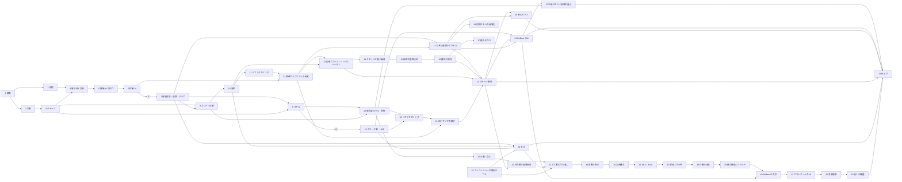

# インゲーム 全体実装計画書

インゲーム開発期間の全体実装計画。
開発は「全体実装計画 → 区間実装計画 → 詳細仕様確定と実装」の 3 段階で進める。
この文書は全体実装計画で、区間ごとの計画は [Sections/](Sections/) にある。

| 資料 | 場所 |
|---|---|
| ゲーム仕様の正本 | Notion「刻断 / 仕様書」（https://app.notion.com/p/49c1ea2aa7fa83aca214017b9e856040） |
| スケジュール | Notion「仕様書 / スケジュール」のマイルストーン（https://app.notion.com/p/3131ea2aa7fa8339acaa01d55399b74a） |
| 時間制御の設計 | Notion「システムリスト / 時間制御（スローモード）」（https://app.notion.com/p/3ea1ea2aa7fa8183bbfac10bfafd4d70） |

作成日：2026-09-29 ／ 更新日：2026-10-21（区間33 をアルファ版の仕上げとして 34〜43 に分け、アウトゲームの未着手の区間を 35・41・42 として載せた）

## 0. 作業者向けの前提

この計画書を受け取って実装する人（AI を含む）は、着手前にここを読む。

### 最初に読むもの

| 対象 | 内容 |
|---|---|
| スキル `state-centrism-architecture` | 5 層の役割、State の Single Writer、Getter インターフェース、参照ルール |
| スキル `usefultoolkit` | BlackBoard・State・Initializer・Compositor・SceneGroup・入力の書き方と、エディタのメニュー |
| [VoxelOverview.md](../Voxel/VoxelOverview.md) | ボクセルを扱う区間（7, 8, 18, 26, 22, 17）で読む |
| [LargeObjectVoxel.md](../Voxel/LargeObjectVoxel.md) | 大きな建物のボクセル（階の積み重ね、素材と強度、倒壊、修復）の方式。区間17・22 と、ダメージタイプを決める区間18で読む |
| [EnemyCrowdDiscussion.md](EnemyCrowdDiscussion.md) | 敵の群衆 AI・崩落による撃破・エネルギーの議論の記録。敵を扱う区間（4〜6・12〜16、7、13）で読む |
| [EnemyCrowdRedesign.md](EnemyCrowdRedesign.md) | 群衆アルゴリズムの改変（二重螺旋、待機・追跡・帰還、区画に分けた距離マップ、交戦の廃止）と、区間13に関わる決定（隊列からの攻撃、ディフェンダーの円形のバリア）。区間12・13・22・17 で読む |
| [EnemySquadRedesign.md](EnemySquadRedesign.md) | 敵の部隊の意思決定とスポーンの改変（スポーン位置 1 つにつき 1 グループ、区画と編成の指定、撤退と補充、全滅後の出し直し、合流の廃止、部隊の意思決定を Application へ移す）。区間14・15・16・22 で読む |
| UsefulToolkit.MeshCut の README | `Library/PackageCache/com.rei.usefultoolkit.meshcut@*/README.md`。切断を扱う区間（2, 3, 4）で読む |
| スキル `code-refactoring`・`comment-refactoring` | リファクタリングの区間（11・20）で読む。ソースコードの整備、コメントの整備の順で使う |

### 手本にする既存コード

| 役割 | 手本 | 要点 |
|---|---|---|
| State | [PlayerMovementState](../../Code/Scripts/BlackBoardLayer/Player/Runtime/PlayerMovementState.cs)、[BuildModeState](../../Code/Scripts/BlackBoardLayer/CoreSystem/ApplicationManagement/BuildModeState.cs) | シーンごとの値は `SceneStateBase`、常駐の値は `GameStateBase`。読み取り用に `IStateGetter` を継承したインターフェースを用意し、`[RegisterBoard(typeof(〜Board))]` を付ける |
| Service（Application） | [PlayerMovementService](../../Code/Scripts/Application/Player/PlayerMovementService.cs) | 具象の State を持つのはこのクラスだけ（Single Writer）。Board へはインターフェースで登録する。`IBlackBoard` をコンストラクタ（DI で先に生成するものは `Initialize`）で受け取り、必要な Board と State は自分で取り出す（[BlackBoardExtensions](../../Code/Scripts/BlackBoardLayer/BlackBoardExtensions.cs)）。入力は `IInputState.RegisterInput` で購読する |
| Adapter（EngineAdapter） | [PlayerMovementAdapterBase](../../Code/Scripts/EngineAdapterLayer/Player/PlayerMovementAdapterBase.cs) | `InitializableMonoBehaviour` を継承し、`Initialize(IBlackBoard ...)` で受け取った BlackBoard から State を取り出して読む。読む State を登録する Service より後に初期化する。取り出せなかったときは基底の `Initialize()` を呼ばず、Update を止めたままにする |
| Initializer | [PlayerInitializer](../../Code/Scripts/Initialization/Player/PlayerInitializer.cs)、[ApplicationManagementInitializer](../../Code/Scripts/Initialization/ApplicationManagement/ApplicationManagementInitializer.cs) | Service と Adapter を生成して配線するだけで、ロジックは持たない。State を集めて渡すことはせず、`IBlackBoard` をそのまま渡す。Inspector で受け取る必須の参照は、最初にまとめて確かめ（[InitializerExtensions](../../Code/Scripts/Initialization/InitializerExtensions.cs) の `IsAssigned`）、足りなければ全部をエラーログに出して止める |
| DI で操作面を渡す | [GameSceneInitializer](../../Code/Scripts/Initialization/Scene/GameSceneInitializer.cs)、[PlayerInputRouteInitializerBase](../../Code/Scripts/Initialization/Input/PlayerInputRouteInitializerBase.cs) | 渡す側は `TryRegisterContent`、受け取る側は `IInjectable<T>` |
| Application と EngineAdapter の直接配線 | [PlayerInitializer](../../Code/Scripts/Initialization/Player/PlayerInitializer.cs) が `PlayerMovementService.Step` を `PlayerMovementAdapterBase.Initialize` に渡す | 毎ステップ変わる値（視線の向き、経過時間）は引数で渡し、結果（打ち出し速度）は戻り値で返す。続く状態は State で渡す |
| EngineAdapter が持つ State | [PlayerContactState](../../Code/Scripts/BlackBoardLayer/Player/Runtime/PlayerContactState.cs) | 物理の判定の結果を、物理ステップの後に Adapter が書く。チラつきは Adapter 側で抑える |

### 守ること

- `// 自動生成ファイル` と書かれたファイル（Compositor、`BuildScenes`、入力の enum など）は手で編集しない。次のメニューで作り直す
  - Initializer を置いた・外した、ChildBoard を足した：`UsefulToolkit/Generate/Scene Compositor`
  - Build Settings のシーンを変えた：`UsefulToolkit/Generate/Scene Enum`
  - 入力アクションを変えた：`UsefulToolkit/Input/Generate Action Enums`
- 新しい asmdef の参照（NavMesh、UsefulToolkit.Debugging など）が必要なら、その層の asmdef に足す。層の参照ルール（スキル `state-centrism-architecture`）を破らない
- コメントとサマリーは、スキル `comment-refactoring` の基準で書く（ユーザーの CLAUDE.md のルール）。変更の経緯は書かず、今の設計判断・仕様判断を書く。装飾を付けない。変数のサマリーは一行。コードから読み取れる否定形を避ける。今後の課題は `// TODO:` にとどめる
- `Assets/Code/Editor/Legacy/` は旧コード。参考にしてよいが、使わない・直さない
- 切断対象にするモデルの FBX は、取り込み設定で Read/Write を有効にする（MeshCut が頂点を読む為。無効だと `MeshDataCache.Register` が登録しない）

### 区間の進め方

1. 区間計画書を読み、今のコードと食い違う箇所があれば先に報告する
2. 「詳細仕様で決めること」の各項目について、案を出してユーザーに確認する。決まったことは区間計画書に書き込む
3. 作業計画（詳細仕様、新しく作る型、コミットの分け方）を立てる。提示する前に `~/.claude/skills/planning-criteria/SKILL.md` を読み、その基準を当てはめる
4. 実装する。確認には uloop のスキル（`uloop-compile`、`uloop-control-play-mode`、`uloop-get-logs` など）を使い、プレイモードで動かして完了条件を確かめる
5. 区間計画書の「状態」を更新し、変更したファイルの一覧と確認の結果を報告して止まる。コミットとプッシュはユーザーが行う

## 1. 技術前提

| 項目 | 内容 |
|---|---|
| 敵のメッシュ切断 | UsefulToolkit.MeshCut を使う。マルチスレッド、Burst、Job で並列化と非同期化が済んでいる |
| 敵の構成 | SkinnedMeshRenderer は使わない。パーツごとに分かれた軽量なメッシュを、パーツ単位で FK / IK で動かす。仮モデルは四足歩行の攻撃する敵（`Assets/Art/Models/EnemyModels/MachineEnemy_Attacker.fbx`。区間10の途中でユーザーが入れ替えた。部位の位置・向き・大きさは区間4 の旧 `AttackerEnemy.fbx` と同じで、三角形は合計 4310、実測。体のプレハブは `Assets/Level/Prefabs/Enemy/AttackerEnemy.prefab`）。同じフォルダに、シールドを持つ敵（`MachineEnemy_Defender`）、吸収型の敵（`MachineEnemy_Finisher`）、ボス（`MachineEnemy_Boss`）のモデルがある。敵のモデルは部位ごとの回転を 0 にして書き出す（脚の IK の `EnemyLegs` が、休みの姿勢の回転を 0 とする為）。取り込み設定は Read/Write を有効にする。1000 体をまとめて描画すると、通常の描画と影で約 862 万の三角形になる（区間5 で計測） |
| 敵の群衆（2026-10-05 決定、2026-10-06 区間5 で確定） | 同時に約 1000 体。敵の状態は構造体の NativeArray（`EnemyAgent`）に持って Burst の Job で更新し、`Graphics.RenderMeshInstanced` でまとめて描画する。切断できる GameObject の体は、近くの敵にだけプールから貸す。経路は縦の列ごとに立てる層を持つ格子と、プレイヤーからの距離マップ。移動は簡易物理で、NavMesh は使わない。詳細は Notion「敵の群衆 AI」「敵の大量描画と体の貸し出し」と、区間5・6 の計画書の「計測の結果」。区間6 の本実装で、1000 体・32 体に体を貸して敵の処理は平均 1.33ms（エディタ、安全チェックなし）。2026-10-09 に、目的地を二重の螺旋（プレイヤー中心の螺旋がグループの目標位置、グループ中心の螺旋がメンバーの定位置）にし、距離マップを区画に分けてプレイヤーの近く（追跡範囲）だけを計算する形に改めた。敵は隊列を離れず、持ち場が追跡範囲の外なら待つ（区間12、[EnemyCrowdRedesign.md](EnemyCrowdRedesign.md)） |
| 大きな建物（2026-10-09 決定） | 1 階分をベイクして縦に積み重ね、近づくまではメッシュで置く。ボクセルは点ごとに素材（マテリアルと融点）を持ち、融点が強度を表す。攻撃は中心・強さ・減衰率を持ち、届く強さが融点以上の所を壊す。階の上下の面のつながりが断たれたら上の階をまとめて倒す。倒れていない建物の傷は、追跡範囲の外でメッシュに戻し、近づいたら記録から当て直す。敵は建物に上れない（区間17、[LargeObjectVoxel.md](../Voxel/LargeObjectVoxel.md)） |
| 敵の体のプール（2026-10-05 決定） | 敵の体は最初にすべてプールに用意し、実行中は Instantiate しない |
| ボスの構成 | 敵と同じく、パーツ単位で FK / IK で動かす。ボクセルのスキニングは使わない |
| ボクセル | ボクセルでできた物はメッシュ切断できない。切断攻撃に破壊属性を付けたときは、切断方向と同じ向きに、厚みゼロの平面でボクセルを分ける（`VoxelPiece.Slice` で実装済み） |
| スローモード | `Time.timeScale` を下げて世界全体を遅くする。プレイヤーのアニメーション、視点操作、UI は等速。倍率の正本は TimeScale State で、`Time.timeScale` と `Time.fixedDeltaTime` に反映するのは EngineAdapterLayer の 1 か所だけ。詳細は Notion「時間制御（スローモード）」 |
| アーキテクチャ | State-Centrism Architecture（Initialization / Application / BlackBoardLayer / ExternalLayer / EngineAdapterLayer）と UsefulToolkit |
| シーン構成（2026-10-05 変更） | 常駐シーン（`UsefulToolkitPersistent`）＋ 場面シーン（アウトゲーム / インゲーム。3 ビルド共通）。場面ごとに 1 つの SceneGroup を持ち、`GameSceneController` が場面の単位で切り替える。プレイヤー一式（リグ、入力の配線、プレイヤーの Initializer）は `InGame` に置き、インゲームの機能を 1 つの DI のスコープにまとめる。プラットフォームごとのリグは `InGame` に置いてビルドモードで選ぶ（選ぶ仕組みは VR のリグを置くときに作る）。リグは実行時に Instantiate しない（Compositor はシーンに置いた Initializer しか初期化しない為）。アウトゲームにはプレイヤーを置かない。以前の「操作シーン（StandardPlayerControl）」は区間3のコミット0で廃止した |
| インゲームのシーン（2026-10-04 決定） | インゲームの場面シーン（`InGame`）には、ステージによらず使うシステム（MeshCut System、敵の生成の仕組み、プレイヤー一式 など）を置く。ライティング、敵の生成位置、置くオブジェクトは、ステージごとのステージシーンに置く。敵などの切断対象は `MeshDataCache` の子に置く必要があるので、`InGame` に置く。ステージシーンを分ける作業は区間4の最初に行う。複数のシーンを読み込んだときは、アクティブなシーンのライティングの設定（環境光、スカイボックス）だけが効くので、ステージシーンをアクティブにする |

## 2. プラットフォームの方針

- 先に PC（マウスとキーボード）で作り、スマホと VR にも随時対応させる
- 各区間の完了条件は PC で判定する
- プラットフォームごとの違いは、EngineAdapterLayer の Adapter（`Standard〜` / `Vr〜`）と入力の層に閉じ込める。Application と BlackBoardLayer はプラットフォームに依存させない
- スマホと VR の既存コード（ビルドモード、Adapter、入力マップ）は壊さずに保つ
- 他プラットフォームへの対応は番号付きの区間とは別に、随時行う。各区間計画書の「他プラットフォームへの対応」に、その区間で気をつけることを書く

## 3. 現状（2026-10-15 時点。区間17・18・19・20 の完了まで。区間21 以降の成果はまだ書き足していない）

| 分野 | 状態 |
|---|---|
| 基盤（5 層の asmdef、UsefulToolkit、常駐シーン、入力の経路、ビルドモード） | あり |
| TimeScale（State、Service、Adapter、デバッグの操作と表示） | あり（区間0）。スローモード（区間9）は、インゲームを出るときに自分がかけたスローを解く。デバッグの操作で変えた倍率は、インゲームを出ても戻らない |
| シーン遷移（`GameSceneController` / `GameSceneInitializer`） | 配線済み（区間0）。常駐シーンから再生すると、アウトゲーム → インゲームの順に入れる。場面シーン（`OutGame` / `InGame`）は `Assets/Level/Scenes/Master/`、SceneGroup アセット（`OutGameGroup` / `InGameGroup`）は `Assets/Level/Data/SceneGroup/`。インゲームのグループはステージごとに `StageData`（`Assets/Level/Data/Stage/`）が持ち、`GameSceneInitializer` の Inspector に並べる（区間19）。`GoToStageAsync` で選んだステージへ、`RetryAsync` で同じステージを読み直す（UsefulToolkit の `ReloadGroupAsync`） |
| プレイヤーの移動（歩行、ダッシュ、ジャンプ、壁走り、短距離ワープ）と視点操作（Cinemachine） | あり（区間1）。PC とスマホが共用するリグ（`PlayerRoot`、`CameraPivot`、`Main Camera`）は `InGame` にある。遊びのルールに関わる値は `PlayerParameterData`、操作の設定（ダッシュの操作方式、切断面の回転角度、視点の感度）は `OperationSettingState`（`AppBoard`、常駐）。開発用の `PlayerMoveTest` は区間1で削除した |
| プレイヤーの HP と被ダメージ | あり（区間1）。`PlayerHealthService.ApplyDamage`（ワープ中は軽減率を適用）と `IPlayerHealthState`。敵の弾とビーム（区間13。`EnemyInitializer` が注入で受け取る）と、デバッグ操作（`PlayerDebugInitializer`）が呼ぶ。インゲームの流れ（`IStageFlowState`）がある間は、プレイ中に受けたダメージだけを適用する（区間19）。流れの State は登録を待って受け取るので、流れのない開発用のシーンでも動く（区間20） |
| 入力（PC の Player マップ） | 区間0で、切断面の回転、ワープ、スローモード、投擲、ランチャー、スキル 1〜3 のアクションを追加済み。Smartphone と VRControllers のマップは未対応 |
| スマホの視点操作 | `TouchLookInputSource` は、タッチ領域の UI に付けて EventSystem のドラッグ通知で動く形になっている。どのシーンにも置かれておらず、InGame には EventSystem もない |
| VR の操作系 | `VrPlayerMovementAdapter` / `VrPlayerInputRouteInitializer` はあるが、どのシーンにも置かれていない。スティックのデッドゾーンは InputActionAsset の `StickDeadzone` が受け持つ。外部入力スロット `VrMove` / `VrLook` は、Player マップのどの Action にもバインドされていない |
| ボクセル（ベイク、削る・盛る、塊の分離、平面での切り分け、融解） | あり。敵の距離マップが形状の変化に追従する（区間6）。プレイ中は、デバッグの破壊攻撃（G キー、`VoxelDestructionAdapter`）で壊せる（区間7）。ベイク（`VoxelModelBaker`）は、大きな三角形で内外の判定を誤る為、ベイクの前にボクセル 16 個分より長い辺を割る（区間17）。支えの判定はなく、分かれたら最も大きい塊が残り、ほかが Rigidbody で落ちる |
| 近接切断（メッシュ切断） | あり（区間2）。左クリックで、ホイールで回した角度の刃（カメラの位置を通る）で範囲内を切る。InGame に `MeshCut System` と、切断を実行する `MeleeCutAdapter`、切れるダミーの敵がある。攻撃は `PlayerInitializer` が `MeleeCutService` から `MeleeCutAdapter.Swing` へ直接配線している（区間2の `PlayerEventBoard` / `MeleeCutEvents` は区間3で廃止）。切断の結果（元の対象とかけら）と切断面は、`PlayerInitializer.DistributeCutResults` が、敵の `EnemySpawnAdapter`、`FragmentOrbAdapter` の順に直接渡している（区間4）。ダミーの敵は区間4 で削除した |
| かけら・オーブ・チャージ | あり（区間3）。InGame の `FragmentOrbAdapter` が、かけらを管理し、寿命（3 秒）が来たらオーブにして、`Camera.main` へ引き寄せて吸収する。吸収した数は `ChargeService.AddFragments` で `IChargeState`（`PlayerBoard`、InGame の SceneState）に加える。スキルの発動で `ChargeService.TryConsume` が消費する（区間8）。かけらは Shard レイヤーで、Shard 同士とプレイヤーとは衝突しない。切ったかけらはぶつかってもオーブにならない（区間9。地面の近くで切ったかけらがすぐオーブになり、スロー中につかめなかった為）。テスト用のステージは `TestWalls/StageBounds` で囲ってある |
| 画面空間の擬似破壊シェーダー（`Shader/Boolean`、`Shader/Embedded`） | コードは残してあるが、Renderer Feature は Renderer から外してある。ボクセルとメッシュ切断で足りているため使っていない |
| ステージシーン | あり（区間4）。`Assets/Level/Scenes/Stage/TestStage/TestStage.unity` にライト・地面・`TestWalls`（`StageBounds`）・`EnemySpawnSystem` を置き、`InGameGroup` は `[TestStage（アクティブ）, InGame]`。TestStage の格子の範囲は 500m 四方（区画 50m）で、段差・壁・橋（`CrowdTerrain`）と、ボクセルの壁とスロープ付きの橋（`CrowdVoxelTerrain`）を置く（区間5・6）。敵の出し方は 2 つあり、有効な方が使われる：`EnemySpawnSystem_Few`（10 体、北と南のスポーン位置に 5 体ずつ。テストプレイ用）と `EnemySpawnSystem_Crowd`（80 区画に 12 体ずつ、計 960 体。群衆の挙動や負荷を見るとき。既定）（区間14） |
| 敵の体と切断 | あり（区間4・5）。InGame の `Enemy`（`EnemyInitializer`、`EnemySpawnAdapter`）が、敵の状態（`EnemyAgent` の NativeArray。有効なスポーン位置の編成の人数の合計）と生成を持つ。ステージシーンの `EnemySpawnSystem` の子のスポーン位置（`EnemySpawnPoint`）1 つにつき、編成（`EnemySquadComposition`）の 1 グループを開始時に出す。1 つの区画に置けるスポーン位置は 1 つ（区間14）。体のプール（Inspector の数、既定 32）、近くの敵への体の貸し出しと返却、切断の受け取りは `EnemyBodyLender`、見た目用の部位（`EnemyDebris`、ディゾルブ `Kizami/EnemyDissolve`）は `EnemyDebrisSpawner` が受け持ち、どちらも `EnemySpawnAdapter` が持つ（区間11）。`EnemyBody` は、接続部側を残す、子の部位を失う、役割（核で倒れる・移動部位 4 つで止まる）、倒れたら切断済みはオーブ・切っていない部位は見た目用の物、を行う。部位の状態は体を返しても `EnemyAgent` に持ち続け、短くなった部位の形は `EnemyShapeKeeper` が預かる。敵は 3 種（`EnemyKind`。区間13）で、種類ごとに体のプールとまとめて描画を持つ。アタッカーは弾（`EnemyShooter`）、ディフェンダーはグループを覆う球のバリア（`EnemyBarriers`。中のプレイヤーは `PlayerMovementService.RequestLaunch` で打ち上げる）、フィニッシャーは宙に浮いて移動し（姿勢は旧作のクリップを変換した Animator）、仲間の吸収と、その場で構えて撃つ極太のビーム（照準 3 秒・予兆 1 秒・照射 1 秒。ボクセルの建物を溶かして進み、当たっている間は 0.1 秒ごとに 1 ダメージ。`EnemyFinisherAttack`・`EnemyFinisherBeams`。区間23）を行う |
| 敵の群衆 | あり（区間5・6・12・14・15・16）。約 1000 体を `EnemyCrowdRenderer`（`RenderMeshInstanced`）でまとめて描画する。経路は格子と距離マップ（`EnemyDistanceField`。初期化のときに物理のクエリで作り、ボクセルの形が変わったら作り直しのあとで変わった列だけ調べ直す。距離は Dial 法の Job で、プレイヤーのいる区画とその周りの 3×3（追跡範囲。区画の大きさは `EnemySpawnSystem`、TestStage は 50m）だけを計算する）。敵はスポーン位置ごとのグループ（`EnemyGroups`、`EnemyGroupJob`。人数は編成の長さで 16 まで）で、待機・追跡・帰還の状態（`EnemyGroupState`）を持ち、持ち場が追跡範囲の外なら待ち、外れたら来た道を戻る。部隊ごとの状態・持ち場・置き場は Application の `EnemySquadService` が決め、`EnemyBoard` の命令（`EnemySquadCommandState`）と観測（`EnemySquadObservationState`）でやり取りする。Engine は置き場の位置（`EnemyEncircleSlotJob`）を求め、命令に従って動かす。追跡範囲の外で待機する部隊は、並び終えたらグループとメンバーの処理を止める（区間15）。追跡中はプレイヤーを中心にした螺旋の置き場（グループの目標位置。来た向きで割り当て、持てなければ外の待つ置き場）へ、アンカーの道筋に沿って 1〜4 列の隊列で進み（1 列の数は進む先 18m の最も狭い幅で決める）、着いたらグループの中心の周りの螺旋に並んでプレイヤーを向く（`EnemyMoveJob`）。交戦（隊列を外れてプレイヤーを囲む動き）はない。撃破の穴詰め、動けない敵（グループから抜けてその場に残る）、戻れない敵（グループのまま持ち場の周りへ移す）の扱いもある。ほかのグループとの合流と、交互の前進はない（区間14 で消した）。体を貸した敵は `EnemyLegs`（脚の IK）で歩く（フィニッシャーは Animator）。体を貸していない敵は、部位ごとの待機姿勢（`EnemyPart`。旧作の待機姿勢に合わせ、足が地面に付く）で描く（区間23）。設定は `EnemySpawnAdapter` の Inspector の「Formation」。追跡中に満員の人数の 60%（`EnemyInitializer` の設定）を失った部隊は撤退してスポーン位置へ帰り、帰り着くと欠けた種類を出して満員に戻る。全滅した部隊は、スポーン位置ごとの間隔（既定 30 秒）のあとに満員で出直す。動けなくなった敵はグループに残り、補充されない。動けるメンバーのいない部隊は止まる。スポーン位置にボクセルの建物（`EnemySpawnCube`、`EnemySpawn` レイヤー）を指定でき、体積の 5% 以上を削られたら補充も出し直しもしない（区間16） |
| 破壊対象とクリア | あり（区間7）。ステージシーンの `DestructionTarget`（`VoxelModelLoader` と同じ GameObject）が、重要パーツ（`PartPath`）が 1 つずつ必要な割合まで削れたら破壊済みにする。`StageClearAdapter` が破壊済みの数を `StageFlowService` へ報告し、すべて破壊済みになったらクリアにする（区間19）。TestStage に門の形の破壊対象を 2 つ置いた。破壊対象は `IDestructionTarget` で、ボクセルの `DestructionTarget` と、普通のオブジェクトの `CoreSystem`（子の `CorePart` にボクセルの塊が当たって分離した割合で壊れる）がある（区間22） |
| インゲームの流れ・HUD・リザルト・ポーズ | あり（区間19）。InGame の `Stage`（`StageInitializer`）が `StageFlowService` を作る。流れ（Ready → Playing → Cleared / Failed）、失敗の理由、倒した数（核と崩落。吸収は数えない）、スコア（倒した数 ＋ クリアの基礎スコア）、ポーズ中かを `IStageFlowState`（`StageBoard`、InGame の SceneState）に書く。失敗条件は `StageData` の `[SerializeReference]` の一覧で、今は `PlayerDeathFailCondition`（HP 0）だけ。クリア・失敗で Player マップを止める。HUD（`StageHudAdapter`）、リザルト（`StageResultAdapter`。Retry と Back to Menu）、ポーズの画面（`StagePauseAdapter`。Esc は UI マップの `Cancel`）は uGUI で、初期化のときにコードで組み立てる（`UiBuilder`）。ポーズは時間の倍率を 0 にし、スローモードは倍率 0 の間はチャージを消費しない |
| アウトゲームとの受け渡し | 仮（区間19）。常駐の `GameProgressState`（`AppBoard`）に、選んだステージ、装備の 3 枠、通貨、クリア済みのステージを持ち、`GameProgressService`（常駐の DI）が書く。仮のアウトゲーム（`OutGameStartInitializer`、OnGUI）で装備とステージを選ぶ。初回クリアで通貨 100（`GameSceneInitializer` の Inspector）。ゲームを終えると消える |
| 崩落による撃破とエネルギー | あり（区間7）。足場ごと 3m 以上落ちた敵（`EnemyMoveJob`）と、落ちてくるボクセルの塊に潰された敵（`EnemyCollapseDetector`）を倒す。かけらは出さない。倒した敵の位置は `EnemyEnergyAdapter`（InGame の `EnemyEnergy`）が GraphicsBuffer で VFX Graph（`EnemyEnergy.vfx`）へ渡し、粒をカメラへ吸い込ませる。チャージは倒したときに `ChargeService.AddCollapsedEnemies` で足す。Enemy と Default のレイヤーは衝突しない（落ちてくる塊が体をすり抜ける為）。TestStage に崩す張り出し（`CrowdVoxelTerrain/Overhang`）を置いた |
| 大きな建物のボクセル | あり（区間17）。`VoxelBuilding` が 1 階分のベイクを縦に積む。点ごとに素材（融点の 3 段階）を持ち、攻撃は強さと減衰率で壊す（`VoxelPiece.ApplyStrike`）。角ばった描き方で壊した周りだけ丸め、当たり判定はチャンクごとの BoxCollider。階の上下の面のつながりが切れたら上の階をまとめて倒し、止まったら地形として残す。階は近づくか攻撃が当たるまでメッシュで置く。傷は階ごとに記録し、追跡範囲（`EnemySpawnAdapter` が渡す）の外でメッシュに戻し、範囲に入ったら当て直す。TestStage に `VoxelBuildingTest`（6m 四方の 6 階と屋上）を置き、囲いを層 `StageBounds`（Player とだけ当たる）へ移した |
| スローモード | あり（区間9）。F で切り替え、`SlowModeService` がチャージを消費して `ITimeScaleController`（常駐の DI）で倍率を 0.25 にする。状態は `ISlowModeState`（`PlayerBoard`）。1 回のスローで振れる回数は 5 回（`SlowModeService.TryUseCut` を `MeleeCutService` へ直接渡す） |
| つかむ・投げる・ランチャー | あり（区間9）。`FragmentThrowService` が右クリック・R・中クリックを受け、InGame の `FragmentThrowAdapter`（`FragmentThrow`）が、かけらを `FragmentOrbAdapter.TryTake` で管理から外してカメラの前に運び、投げる・装填する・撃つ。飛ばしたかけらは最初にぶつかった時点でプールへ返り、チャージにならない |
| 装甲 | あり（区間10）。メッシュのパネル（`ArmorPanel`、Armor レイヤー、1.3m 角）がパネルごとに耐久値 10 を持つ。剣・スキル・G キーは 1 回当たるごとに 1 減らし、投げた・撃ったかけらは当たったパネルを一撃で壊す。ビームは装甲で止まり、爆発と G キーは装甲の奥を削らない。パネルはプレイヤーを通さない。TestStage の門 A の核 2 つを殻（`ArmorCoreShell.prefab`、24 枚）で囲み、剣の確認用の壁 `ArmorTestWall` を開始位置の近くに置いた |
| ダメージタイプと判定の窓口 | あり（区間18）。`DamageType`（BlackBoard、Flags の enum：攻撃・破壊・粉砕）を攻撃が持ち、装甲への効き方は `ArmorPanel.ApplyDamage` の 1 か所で決める（粉砕を含めば一撃、攻撃か破壊を含めば耐久値を 1 減らす） |
| スキル | あり（区間8）。1 キーで前方ビーム（消費 30。カメラから視線の向きへ半径 1m・長さ 30m のカプセルで削り、壁を貫通する）、2 キーで自分中心の爆発（消費 50。カメラの位置を中心に半径 4m の球で削る）。`SkillData`（External）を、アウトゲームで選んだ装備（`GameProgressState`。アウトゲームを通さずに始めたときは `PlayerInitializer` の Inspector の 3 枠）から受け取り、`SkillService` が入力を受けてチャージを消費し、`VoxelDestructionAdapter` の `CarveBeam` / `CarveExplosion` を呼ぶ。チャージが足りなければ発動も消費もしない。クールタイムと見た目の演出はない。スキルは敵に当たらない（Enemy のレイヤーを除いて削る）。区間18で、回復（`SkillEffect.Heal`）と強化型 5 種（ボクセル破壊・シルブレ・範囲アップ・速さアップ・かけらの爆発。`PlayerEnhanceService` が実時間か攻撃の回数で切れる効果を持つ）を足し、HUD にスキルごとのアイコンと可・不、チャージの数値を出した。HUD の表示は、区間19の `StageHudAdapter`（uGUI）へ移した。アイコンは `StageHudAdapter` が `ISkillSlotState.GetIcon` から読む（区間20） |
| 旧構成 | `Test/InGame.unity` と `Test/OutGame.unity`、`Assets/Level/Prefabs/` の既存プレハブ（`Enemy/AttakkerEnemy.prefab` など。区間4 で作った `Enemy/AttackerEnemy.prefab` は除く）は旧構成のもの。旧 FBX `AttakkerEnemy.fbx` と区間4 の `AttackerEnemy.fbx` は、区間10の途中でユーザーが消した。旧構成の `AttakkerEnemy.prefab` と開発用のシーン（`ShaderTest`、`VoxelModelTest`）は、参照が切れたまま。`Assets/Art/` は区間4 から git の対象。`Test/InGame.unity` は Build Settings から外してあり、`BuildScenes.InGame` は新しい `Master/InGame` を指す |

## 4. 進め方

- 先に「刻む → 溜まる → スキルで壊す → クリア」のコアループを、仮の見た目で一周させる。そのあとで、スロー、装甲、敵の種類、強化型スキルを足していく
- ダメージタイプは「攻撃が持つデータ」として持つ。攻撃と対象ごとの判定をどこに置くかは、区間7の着手時に決める（2026-10-05 変更）。計画当初は Application の 1 か所の窓口にまとめる予定だったが、区間2〜4では、切断・オーブ化・敵のルールを、利用者が 1 つであることから EngineAdapter に置いている。また、切断は EngineAdapter の `MeleeCutAdapter` が MeshCut を直接呼んでおり、Application の asmdef は MeshCut を参照していない。区間7・8では、ダメージを受けるのがボクセルだけだった為に窓口を作らず、区間9（粉砕のダメージ）へ持ち越した（区間8の決定 7）。区間9・10でも作らず、区間10では装甲の受け手（`ArmorPanel`）を各攻撃の Adapter から直接呼ぶ形にした。1 つの攻撃が複数の種類を持つようになる区間18で作る（区間10の決定 6）
- 各区間は 0 章の「区間の進め方」の順で進める
- 区間計画書は、着手する直前にその時点の実装に合わせて見直す

## 5. 区間一覧

表は実施する順に並べ、番号も実施順に振っている（2026-10-20 に振り直した。旧番号との対応は下の「旧番号との対応」）。

| # | 区間 | 主な内容 | 前提 | 目安の時期 | 最速の推定 | 状態 | 計画書 |
|---|---|---|---|---|---|---|---|
| 0 | 基盤整備 | TimeScale State と Adapter、シーン遷移の配線とインゲームのシーン、PC 用入力マップ、デバッグ手段 | ― | 2026/09/29〜10/05 | ― | 完了（10/04） | [Section00](Sections/Section00_Foundation.md) |
| 1 | プレイヤー移動の完成 | ダッシュ、ジャンプ、壁走り、短距離ワープ、HP と被ダメージの窓口 | 0 | 10/06〜10/12 | ― | 完了（10/04） | [Section01](Sections/Section01_PlayerMovement.md) |
| 2 | 近接切断 | MeshCut による剣の切断、ホイールで切断面を回転、切断面のプレビュー、切断の結果（かけらと元の対象）の取得 | 0 | 10/13〜10/19 | ― | 完了（10/05） | [Section02](Sections/Section02_MeleeCut.md) |
| 3 | かけら・オーブ・チャージ | かけらの通知、かけらのオーブ化と自動吸収、チャージの State、ステージ外周コライダー、オーブのプール | 2 | 10/20〜10/26 | ― | 完了（10/05） | [Section03](Sections/Section03_Charge.md) |
| 4 | 敵の体と切断 | ステージシーンの分離、生成システム、敵の体のプール、部位の役割（核・攻撃・移動）、接続部側が残る切断、部位ごとの切断回数の上限、核でだけ倒れる、ディゾルブ、仮の移動 | 1, 3 | 2026/10/06〜10/19 | 10/06〜10/09 | 完了（10/06） | [Section04](Sections/Section04_Enemy.md) |
| 5 | 群衆 AI の試作と計測 | 敵の状態（NativeArray）、まとめて描画、距離マップの試作、体の貸し出しと返却、貸した体の切断、計測と方式の決定 | 4 | 10/20〜11/02 | 10/10〜10/13 | 完了（2026-10-06） | [Section05](Sections/Section05_CrowdPrototype.md) |
| 6 | 群衆 AI の本実装 | 距離マップ（速くする、ボクセルへの追従）、グループとアンカー、隊列、交戦と合流、簡易物理、戻れない敵、脚の IK | 5 | 11/03〜11/16 | 10/14〜10/17 | 完了（2026-10-07） | [Section06](Sections/Section06_CrowdAI.md) |
| A | マイルストーンA | 群れで迫る敵を切って溜める | | 19/24 | 10/17 | | |
| 7 | 破壊対象・崩落・クリア判定 | ボクセルの破壊対象、重要パーツの体積割合、マップオブジェクト、崩落による撃破、エネルギーの演出（VFX Graph）、クリア判定。ダメージタイプと対象ごとの判定は区間8へ持ち越す（区間7の決定 1） | 6 | 11/17〜12/07 | 10/18〜10/23 | 完了（2026-10-07） | [Section07](Sections/Section07_DestructionTarget.md) |
| 8 | スキル基盤・攻撃型スキル | スキルの定義データ、装備枠 3、チャージ消費、攻撃型スキル 2 種、仮の HUD | 3, 7 | 12/08〜12/14 | 10/24〜10/25 | 完了（2026-10-08） | [Section08](Sections/Section08_Skill.md) |
| B | マイルストーンB | 1 ステージが最初から最後まで遊べる | | 26/14 | 10/25 | 達成（2026-10-08） | |
| 9 | スローモード・つかみ・投擲・ランチャー | TimeScale の倍率操作、ゲージ消費、スロー中の切断回数の上限、かけらのつかみ・投擲・ランチャー、粉砕ダメージ | 3, 7 | 12/15〜12/28 | 10/26〜10/29 | 完了（2026-10-08） | [Section09](Sections/Section09_SlowMode.md) |
| 10 | 装甲 | 耐久値、粉砕タイプで一撃破壊、破壊ダメージの遮断、破壊対象の防御パーツ | 7, 9 | 12/29〜2027/01/04 | 10/30〜10/31 | 完了（2026-10-08） | [Section10](Sections/Section10_Armor.md) |
| 11 | リファクタリング | ソースコードの整備（スキル `code-refactoring`）のあと、コメントの整備（スキル `comment-refactoring`）。挙動は変えない | 10 | 01/05〜01/11 | 10/09〜10/10 | 完了（2026-10-08） | [Section11](Sections/Section11_Refactoring.md) |
| 12 | 群衆アルゴリズムの改変 | 二重の螺旋（グループの目標位置とメンバーの定位置）、待機・追跡・帰還、区画に分けた距離マップ（追跡範囲）、交戦の廃止 | 6, 11 | 01/12〜01/25 | 10/09〜10/12 | 完了（2026-10-09） | [Section12](Sections/Section12_CrowdRedesign.md) |
| 13 | 敵の固有アクション・バリエーション | 敵の種類と編成、雑魚 3 種の固有のアクション（攻撃する敵の弾、ディフェンダーの円形のバリア、吸収型の敵の分身とビーム）。特殊部位は持ち越す | 12, 10 | 01/26〜02/08 | 10/13〜10/16 | 完了（2026-10-10） | [Section13](Sections/Section13_EnemyVariation.md) |
| 14 | スポーン位置と編成 | スポーン位置 1 つにつき 1 グループ、区画と編成（ScriptableObject）の指定、初期生成の範囲と間隔の生成と合流をなくす、区画とスポーン位置のデバッグ表示 | 13 | 02/09〜02/15 | 10/11〜10/12 | 完了（2026-10-10） | [Section14](Sections/Section14_SquadSpawn.md) |
| 15 | 部隊の意思決定 | 部隊の状態と目的地を Application が決めて State で公開し、EngineAdapter が経路と隊列を制御する。挙動は変えない | 14 | 02/16〜03/01 | 10/13〜10/16 | 完了（2026-10-11） | [Section15](Sections/Section15_SquadDecision.md) |
| 16 | 撤退と補充 | 損耗で撤退して持ち場で補充、全滅後の出し直し、臨時の拠点、スポーン位置の破壊 | 15 | 03/02〜03/08 | 10/17〜10/18 | 完了（2026-10-11） | [Section16](Sections/Section16_SquadReinforce.md) |
| 17 | 大きな建物のボクセル | 1 階分の計測、素材と強度（点ごとの融点）、階の積み重ねと倒壊、メッシュからの差し替えと傷の修復 | 7, 12 | 03/09〜03/29 | 10/19〜10/24 | 完了（2026-10-15） | [Section17](Sections/Section17_LargeVoxelBuilding.md) |
| 18 | 強化型スキル・回復 | ダメージタイプのデータと判定の窓口（区間10から持ち越し）、各攻撃の強さと減衰率（区間17）、ダメージタイプの付与などの強化型スキル、破壊属性の切断でボクセルを平面で切り分ける、HP を回復するスキル | 8, 9 | 03/30〜04/12 | 10/25〜10/28 | 完了（2026-10-15） | [Section18](Sections/Section18_EnhanceSkill.md) |
| 19 | ステージ制・インゲームの流れ・HUD | ステージデータ、HUD、失敗（HP 0）、リザルトとスコア、リトライ、アウトゲームとの受け渡し、ポーズ | B | 04/13〜04/26 | 10/29〜11/01 | 完了（2026-10-15） | [Section19](Sections/Section19_StageFlow.md) |
| 20 | リファクタリング | ソースコードの整備（20-1、スキル `code-refactoring`）、コメントの整備（20-2、スキル `comment-refactoring`）、計画書の修正（20-3）。挙動は変えない | 18, 19 | 2026/10/15 | ― | 完了（2026-10-15） | [20-1](Sections/Section20-1_SourceRefactoring.md)・[20-2](Sections/Section20-2_CommentRefactoring.md)・[20-3](Sections/Section20-3_PlanRevision.md) |
| 21 | 広いマップの格子 | 格子と距離マップの配列の持ち方、壊れない部分の格子の事前の焼き付け（区間6・12 から持ち越し） | 12, 20 | 2026/10/16〜10/22 | 10/16 | 保留（2026-10-16。問題が出たら着手） | [Section21](Sections/Section21_WideMapGrid.md) |
| 22 | ステージ制作 | チュートリアル、殲滅、崩壊、到達の 4 ステージ（ボス戦は区間26。破壊対象、マップ、大きな建物、スポーン位置と編成、ギミック、チュートリアルの案内）、案内の台本と文、コアシステム、制限時間の失敗条件、建物の傷の記録、失敗条件を足す表示、敵の設定の値 | 13, 16, 19, 17, 21 | 10/23〜11/05 | 10/17〜10/20 | 完了（2026-10-20。22-8 は持ち越し） | [Section22](Sections/Section22_StageContent.md) |
| 23 | フィニッシャーの極太ビームと旧作の姿勢 | フィニッシャーの攻撃を、その場で構えて撃つ極太ビーム（ボクセルを溶かして進む、継続ダメージ）に作り直す。分身と上空への移動を削除。遠くの敵とフィニッシャーの姿勢を旧作 HDRPHookShot に合わせる | 13, 17 | 未定 | 未定 | 完了（2026-10-18） | [Section23](Sections/Section23_FinisherBeam.md) |
| 24 | Brilliant Skill | よい行動の判定（左上のログの種類と対応）、追加スコアの口、つかんで投げられる物理のボクセルの文字（つかみ中は無敵・静止・狙い）、演出 | 19, 22, 17 | 11/06〜11/12 | 10/21 | 完了（2026-10-20） | [Section24](Sections/Section24_BrilliantSkill.md) |
| 25 | 街のマップ | 半径 350m の円形の街（未来の東京）、建設途中の建物 10 種・小物・敵の生産装置のモデル、崖と奈落、外殻エリアと外壁、バリアのドーム、建物のボクセル化（天照塔は Y 40〜65m）、14B のステージの載せ替え | 22, 17 | 未定 | 未定 | 完了（2026-10-20） | [Section25](Sections/Section25_TownMap.md) |
| 26 | ボス | ボクセルのパーツをパーツ単位で動かすボス、ボス戦のステージ | 7, 10, 19 | 11/13〜12/03 | 10/22〜10/27 | 完了（2026-10-20。26A・26B・26C に分けた） | [Section26](Sections/Section26_Boss.md) |
| 26A | ボスの体と武装 | 移動と脚、武装 4 種（タレット・下部レーザー・脚のミサイル・アウトリガー）、5% 削れたら武装の破壊 | 7, 10, 18 | 未定 | 未定 | 完了（2026-10-20） | [Section26A](Sections/Section26A_BossBody.md) |
| 26B | ボスとの直接戦闘 | 円形の空間、足踏み、コアの露出、隙、総攻撃、停止と破壊属性の自動付与、クリア | 26A, 13, 19 | 未定 | 未定 | 完了（2026-10-20） | [Section26B](Sections/Section26B_BossDirectBattle.md) |
| 26C | 水晶の段階とボス戦のステージ | 水晶、遠距離の攻撃、吸収と頭部のレーザー、飛来、町のシーンを共有するボスステージ | 26B, 23, 22 | 未定 | 10/19 | 完了（2026-10-19） | [Section26C](Sections/Section26C_BossCrystalPhase.md) |
| 27 | 近接スキルと破壊の重心 | 初期スキルの頑拳（消費 10）と突撃（消費 15）、ボロノイ状の破砕、すべての破壊に共通する重心の偏り、通常攻撃とスキルで共有する発動の制約、初期装備を頑拳 1 つにする。2026-10-19 に、頑拳＝体術・衝波、突撃＝体術・攻走として、アウトゲームの区間5（[OutGame Section05](../OutGame/Sections/Section05_SkillRework.md)）に統合した | 8, 18, 19, 17, 24 | 未定 | 未定 | 統合済み（アウトゲームの区間5へ。2026-10-19） | [Section27](Sections/Section27_CloseRangeSkill.md) |
| 28 | 初期スキルの破壊力 | 衝波・攻走の 3〜4 回でビル 1 棟を崩す。鉄筋も削れるが効率は低い | 17, OutGame 5 | 未定 | 未定 | 完了（2026-10-20） | [Section28](Sections/Section28_InitialSkillPower.md) |
| 29 | 土遁・造山 | 覇剣を置き換える。長押しでボクセルを盛って大きくし、通常攻撃で切れる | 18, OutGame 5 | 未定 | 未定 | 実装済み（最終確認はレビュー時） | [Section29](Sections/Section29_Zouzan.md) |
| 30 | 敵の広がり | 隊列の間隔を広げ、通常攻撃でまとめて倒せる数を減らす。着いたグループのメンバーを空いている床に割り当て、遠回りでしかたどり着けない列を置き場から外す | 16 | 未定 | 未定 | 完了（2026-10-20） | [Section30](Sections/Section30_EnemySpread.md) |
| 31 | 体力制の破壊対象 | 体力が尽きるまで壊せない対象、上部の体力ゲージ、崩壊の半球の対象、殲滅の撃破数の条件 | 29, 22, 19 | 未定 | 未定 | 実装済み（最終確認はレビュー時） | [Section31](Sections/Section31_TargetHealth.md) |
| 32 | ボス戦の作り直し | ボスの体力、直接戦闘 → 遠距離 → 直接戦闘 → 最終、降下フィニッシャー、武装を 1 つ選んで壊す、隙間のない円形の空間 | 31, 26C, 23 | 未定 | 未定 | 実装済み（2026-10-21。通して遊ぶ確認はレビュー時） | [Section32](Sections/Section32_BossRework.md) |
| 33 | 仕上げ（アルファ版の完了） | 34〜43 の親。作業は子の区間で行う | 全部 | 12/04〜12/17 | 10/28〜10/31 | 未着手（子の区間に分けた） | [Section33](Sections/Section33_Polish.md) |
| 34 | プレイヤーの挙動の修正とスキルの範囲 | 段差で空へ飛ぶ不具合、慣性の強すぎる移動、向いている方向への壁キック、スキルの範囲を正面に広げる | 32 | 未定 | 未定 | 実装済み（2026-10-21。到達での確認は持ち越し） | [Section34](Sections/Section34_PlayerFix.md) |
| 35 | 火術奥義・羽天轟号 | 上空から撃つ、視点を動かせる無敵のビーム | 34、アウトゲームの区間5 | 未定 | 未定 | 未着手 | [Section35](Sections/Section35_Utenkougou.md) |
| 36 | SE と BGM | 音の土台（AudioMixer と音量の反映）、BGM、SE 4 つ（ガラス・装甲・ボクセル攻撃・崩壊）。ほかの SE とスロー中の音は持ち越し | 35 | 未定 | 未定 | 未着手 | [Section36](Sections/Section36_Sound.md) |
| 37 | 爆発とがれき | 爆発のエフェクト、壊した物から落ちるがれき（エフェクト） | 36 | 未定 | 未定 | 未着手 | [Section37](Sections/Section37_ExplosionDebris.md) |
| 38 | プレイヤーの行動の演出 | 腕のアニメーション、行動のエフェクト、ヒットストップ | 37 | 未定 | 未定 | 未着手 | [Section38](Sections/Section38_PlayerFeel.md) |
| 39 | 敵の弾道とシールドの表示 | アタッカーの弾道の軌跡、ディフェンダーのシールドの耐久値の表示 | 38 | 未定 | 未定 | 未着手 | [Section39](Sections/Section39_EnemyVisual.md) |
| 40 | Brilliant Skill の文字の見せ方 | 文字が出そろうまで、画面の手前でプレイヤーに追従させる | 24, 39 | 未定 | 未定 | 未着手 | [Section40](Sections/Section40_BrilliantDisplay.md) |
| 41 | アルファ版の UI | アウトゲームの画面のデザインとプレハブ化 | 40、アウトゲームの区間1・2・4 | 未定 | 未定 | 未着手 | [Section41](Sections/Section41_AlphaUi.md) |
| 42 | 背景映像 | マップを周回するカメラの映像をアウトゲームで流す | 41 | 未定 | 未定 | 未着手 | [Section42](Sections/Section42_BackgroundVideo.md) |
| 43 | 通しの調整と不具合の修正 | 負荷とパラメータの調整、不具合の修正、HUD の見た目、使っていないコードとアセットの削除 | 42 | 未定 | 未定 | 未着手 | [Section43](Sections/Section43_FinalTuning.md) |

- 目安の時期と最速の推定は、そのときどきの割り方で引いた値のまま残している。区間0〜3 は計画の約 4 倍、区間4〜19 は約 20 倍の速さで終わった。最後に引き直したのは 2026-10-15（区間20-3）で、そのときの完了の目安は 2026/12/17、完了の最速の推定は 2026/10/31
- 区間12 は、区間13のディフェンダーの円形のバリアと隊列からの攻撃が、二重螺旋の並び方の上に成り立つ為に、区間13の前に置いた
- 区間17 は、区間18のダメージタイプの表で、各攻撃の強さと減衰率を装甲への効き方と一緒に決められるよう、区間18の前に置いた
- 区間24（Brilliant Skill）は、判定の条件の値が本番のステージの敵の数や建物の大きさで決まるので、区間22のあとに置いた（区間19の決めたこと 13）
- 区間27 は、スキル発動と縁が深い区間24のあとに置いた。2026-10-19 にアウトゲームの区間5へ統合したので、この計画では閉じている
- 区間28〜32 は 2026-10-19 に足した。ユーザーが「壊すこと自体は面白いが挑戦性がない。殲滅・崩壊・ボス戦は対象をちょっと壊すだけ」と判断し、壊す手段を強める（28・29）、通常攻撃を相対的に弱める（30）、ミッションの対象とボスを体力制にする（31・32）と決めた為。28・30 はほかの区間に依存しない。31 は 29 の「通常攻撃で切れる」印を使い、32 は 31 の体力の仕組みを使う。時期は未定
- 区間21（広いマップの格子）は保留のまま。今の格子で問題が出たら着手する（43-4）
- 到達ステージは、飛び移り（区間34 の計画の外で追加）の挙動が安定しなかったため、2026-10-21 にステージ選択から外した（ステージのアセットとシーンは残してある）。戻すときは、常駐シーンの `GameSceneInitializer._stages` に `ArrivalStageData` を足し、区間34 の持ち越し（飛び移りの確認、各スキルで天照塔を倒せるか）を確かめる
- 区間33 は 2026-10-21 に、アルファ版の仕上げとして子の区間 34〜43 に分けた。アウトゲームの未着手の区間（旧 3・6・7）もアルファ版の完了に必要なので、インゲームの区間 42・35・41 に移した。順番はユーザーの優先度（機能がないもの → 体験に直結するもの → あった方が良いもの → システムの都合）で決めた。理由は [Section33](Sections/Section33_Polish.md) の「アルファ版の仕上げの区間」

### 旧番号との対応

2026-10-20 より前のコミットメッセージ、ブランチ名、Notion には旧番号が残っている。計画書の本文の「区間N」は新しい番号に直した。ただし、各区間計画書の作業の番号（旧区間8の「8-2」など）と、「区間」の付かない番号は旧番号のまま残っている箇所がある。

| 旧 | 新 | 旧 | 新 | 旧 | 新 |
|---|---|---|---|---|---|
| 0〜3 | 0〜3 | 4E | 14 | 14C | 25 |
| 4A | 4 | 4F | 15 | 12（12A・12B・12C） | 26（26A・26B・26C） |
| 4B | 5 | 4G | 16 | 17 | 27 |
| 4C | 6 | 15 | 17 | 19 | 28 |
| 5 | 7 | 10 | 18 | 20 | 29 |
| 6 | 8 | 11 | 19 | 21 | 30 |
| 7 | 9 | 11R（20-1〜3） | 20（20-1〜3） | 22 | 31 |
| 8 | 10 | 14A | 21 | 23 | 32 |
| 8R | 11 | 14B（14） | 22 | 13 | 33 |
| 4D | 12 | 18 | 23 | | |
| 9 | 13 | 16 | 24 | | |

依存関係

## 6. 使う既存機能

| 用途 | 使うもの |
|---|---|
| 敵の切断 | UsefulToolkit.MeshCut（`MultiCutBlade` / `MultiMeshCut` / `CuttableObject` / `MeshDataCache` / `MeshCutObjectPool`）。シーン上では `MeshCut System` の下に `MeshDataCache` / `FragmentPool` / `CutBlade` という名前で置かれる。`MultiCutBlade.ExecuteCut` は切断した対象ごとに `MultiCutResult`（`Original` / `Front` / `Back`）を返す（区間2で拡張）。区間4 で、`MeshDataCache.Register`（実行中に 1 つ登録）、`CuttableObject` の切断回数の上限（`MaxCutCount` / `CutCount`。かけらへ引き継ぐ）、`AdoptCutShape`（かけらの形を移す。`AdoptColliderMode.FitOwnColliders` で元のコライダーを残った形に合わせる）、`RestoreInitialShape`（切断前の形に戻す）を拡張した。拡大率は `localScale` で扱うので、切断対象の親に拡大率を持たせない |
| かけらの上限 | `MeshCutObjectPool` は固定長のリングバッファで、空きがなくなると最も古いかけらを回収して使い回す |
| 敵の移動 | 自作の距離マップと簡易物理（Burst の Job）。格子は `RaycastCommand` と `OverlapBoxCommand`（物理のバッチのクエリ）で作り、ボクセルの形状変化は `VoxelModelLoader` の通知と `VoxelPiece.PendingChunkCount`（作り直しが済んだか）で追う（区間6）。`com.unity.ai.navigation`（NavMesh）は導入済みだが、使わない（Notion「敵の群衆 AI」） |
| 敵の大量描画 | `Graphics.RenderMeshInstanced`（区間5 で採用。1 回に 511 体まで描けるので、それを超える分は分けて描く）。マテリアルは GPU インスタンシングを有効にしたアセットにする（プロジェクトはインスタンシングのバリアントを使われていなければ削る設定の為）。BatchRendererGroup と GPU Resident Drawer は使わない |
| 敵の脚 | 2 本の骨の IK を自前で解く（区間6 の `EnemyLegs`）。Animation Rigging（TwoBoneIK）は、体ごとに Animator と RigBuilder が要り、足を置く位置の決め方は結局自前で作るので使わない |
| 計測 | Unity の `ProfilerMarker` と `ProfilerRecorder`（Burst の Job の中の時間も、ワーカースレッドの分まで取れる） |
| オーブの再利用 | `UnityEngine.Pool.ObjectPool<T>`（区間3の `FragmentOrbAdapter` が使っている） |
| 散らばる部位の再利用 | UsefulToolkit.framework の `RecycleBuffer<T>`（固定長のリングバッファ）。区間4 の `EnemyDebris`（区間11 から `EnemyDebrisSpawner` が持つ）。敵の体のプールは、空きがなければ出さない規則なので、`List` で持つ |
| 部位の役割の選択 | UsefulToolkit.framework の `SubclassSelectorAttribute`（`[SerializeReference]` のフィールドにサブクラスを選ぶ表示を付ける） |
| かけらの接触 | かけらのプレハブに付けた `FragmentContactReporter`（`OnCollisionEnter`）。接触のコールバックは Rigidbody と同じ GameObject のコンポーネントにしか届かない為。ぶつかったかけらと相手のコライダーを渡す（区間9） |
| かけらを持つ間に切らせない | UsefulToolkit.MeshCut の `CuttableObject.DisableCutting`（プールへ返すと `OnRecycle` で切れる状態に戻る）（区間9） |
| 装甲 | 区間10の `ArmorPanel`（パネルごとの耐久値）。遮断は Armor レイヤーへの `Physics.Raycast` で判定し、爆発で当てるパネルは `Physics.OverlapSphereNonAlloc` で集める。破壊対象とのひも付けは持たない |
| 速く飛ぶかけらの当たり | 投げた・撃ったかけらは、飛んでいる間だけ `CollisionDetectionMode.ContinuousDynamic` にする。Discrete だと薄い装甲のパネルを 1 ステップで越え、奥の物への接触が先に届く（区間10） |
| カメラに合わせて物を置く | CinemachineBrain は実行順の指定なしに `LateUpdate` でカメラを動かすので、カメラに合わせる側に `[DefaultExecutionOrder]` で後ろの実行順を付ける（区間9の `FragmentThrowAdapter`） |
| シーン遷移 | `GameSceneController` / `GameSceneInitializer`、SceneGroup アセット（`GameSceneGroupData`）、UsefulToolkit の `SceneLoadService.ReloadGroupAsync`（ロード済みのグループの読み直し。区間19のリトライ） |
| ログ | UsefulToolkit の `UsefulLogger`（`LogError` はエディタと Development Build、それ以外はエディタだけで出る）。Voxel の実行時コードも区間11 で揃えた。UsefulToolkit を参照しないエディタ専用の asmdef（ベイク、デバッグツール）は `Debug.Log` |
| デバッグ表示 | UsefulToolkit.Debugging の `DebugGUI`（`ObserveVariable` で値を画面に出す。シーンのオブジェクトから登録するときは持ち主に `this` を渡し、シーンのアンロードで外す（区間19）。シーンへの配置は `UsefulToolkit/ProgramTools/DebugGUI Setup`）、State の `GetLog()` |
| ポーズ | `ITimeScaleController.SetScale(0)` と、Player マップの停止（区間19の `StageFlowService`）。常駐の `PauseBoard` / `IPausable`（UsefulToolkit.ProgramTools）は、止める対象が 1 つなので使っていない |
| プレイヤーの物理 | Rigidbody（補間、ContinuousDynamic）、摩擦ゼロの PhysicsMaterial、`Physics.SphereCast`（接地）、`Physics.OverlapCapsuleNonAlloc` と `Collider.ClosestPoint`（壁） |
| カメラ | Cinemachine |
| エフェクト | VFX Graph。崩落で倒した敵のエネルギーは、位置を GraphicsBuffer で渡し、イベントを 1 フレームに 1 回送る（区間7の `EnemyEnergyAdapter`）。グラフはエディタで手で組む（スクリプトから組む公開の方法がない為。組み方は `Sections/Section07_EnergyVfxGraph.md`） |
| 破壊対象・マップ | 既存のボクセル（`VoxelModelLoader` / `VoxelPiece` / `IVoxelShape`）。重要パーツの削れた割合は、パーツの `RelativeVolume`（切り離した塊を含まない）から求める（区間7） |
| Unity CLI Loop（uloop） | `Packages/manifest.json` で v3.13.0 のタグに固定した（区間7）。タグなしだと main の最新を取り、未公開の project runner を指すことがある為。上げるときはタグを書き換える |
| 破壊属性の切断 | `VoxelPiece.Slice`（厚みゼロの平面で切り分ける） |
| 破壊後の重心の偏り | Unity 標準の `Rigidbody.centerOfMass` と `ResetCenterOfMass()`（区間27の予定。独自の物理は作らない） |
| 大きな建物 | 区間17の `VoxelBuilding`。攻撃は `VoxelPiece.ApplyStrike`（強さと減衰率）で当てると、素材の強度と傷の記録が効く。使い方は [Section17](Sections/Section17_LargeVoxelBuilding.md) の「実装結果」 |
| フィニッシャーの姿勢 | Unity 標準の Animator とクリップ（区間23）。旧作のクリップをエディタのメニュー（Kizami/Finisher/Build Animations）で kizami の体用に変換する。IK は使わない |
| 遠くの敵の待機姿勢 | 部位ごとの待機姿勢（`EnemyPart`）を、エディタのメニュー（Kizami/Enemy/Bake Idle Poses）で焼き込む（区間23） |
| ビームの見た目 | URP の HLSL シェーダー（`Assets/Code/Shader/FinisherBeam/`）、`MaterialPropertyBlock`、`ParticleSystem`（火花）、Cinemachine の `CinemachineImpulseSource`（画面の揺れ。カメラに `CinemachineImpulseListener`）（区間23） |
| 破壊スキルの演出 | 既存のボクセルの融解（Thermal / Melt）が候補。区間8では使わず、区間33（または区間18）で決める。`VoxelMeltSystem` は InGame にも TestStage にも置かれていない |
| 体力制の破壊対象 | 区間31の `HealthTarget`（`VoxelPiece.SetProtected` で全パーツを保護し、体力が尽きたら外す）と `TargetHealthService` / `TargetHealthState`（`StageBoard`）。落ちる塊は `Physics.OverlapBox` で調べる（接触のコールバックは Rigidbody の側にしか届かない為）。対象はステージの破壊対象のギミックで選ぶ。`TargetHealthService` は `InGameCompositor` に登録され、ボスは区間32 で全回復・無敵・時間で減る・停止のひびの表示に使う |

## 7. 未確定の仕様と、決める区間

| 区間 | 決めること |
|---|---|
| 0 | TimeScale State の置き場所、シーンの作り方と置き場所、アウトゲームからインゲームへの仮の入り方、入力の割り当て |
| 1 | ワープ中のダメージ軽減率、各移動パラメータ、壁走りに入る条件 |
| 2 | 切断判定の方式、攻撃の範囲と間隔、生まれたかけらを受け取る方法 |
| 3 | かけらの通知の経路、かけらを再度切ったときのチャージの数え方、ゲージの上限、かけらが強制回収されたときの扱い |
| 4 | 散らばる部位の見た目（GameObject か VFX Graph か）、接続部の近くとみなす距離、動けなくなる移動部位の数 N、部位の系統ごとの切断回数の上限値、生成情報の中身、仮モデルの FBX の扱い |
| 5 | 体を貸す距離・返す距離と数、短くなった部位を貸し直すときの戻し方、まとめて描画する方法、格子のマスの大きさ、敵の状態とルールを置く層 |
| 6 | 1 グループの人数と隊形、交戦に入る・抜ける距離、動けない敵の隊列での扱い、距離マップの半径と頻度、歩き方 |
| 12 | 持ち場の位置、帰りの道筋の持ち方、追跡を始める・やめるきっかけ、屋上のプレイヤーの起点、敵が上れる高さの上限の持ち方（仕様は [EnemyCrowdRedesign.md](EnemyCrowdRedesign.md) で確定済み。2026-10-09 に決めた。答えは区間12 の計画書） |
| 7 | 重要パーツの指定方法、本体から分離した塊を破壊済みに数えるか、クリアに必要な割合をどの単位で持つか、ダメージの判定を置く層、崩落で撃破になる条件、崩落で撃破した敵 1 体あたりのチャージ量と足すタイミング |
| 8 | 最初に作る攻撃型スキル、消費量、ダメージのデータと判定の窓口を置く層、破壊ダメージの量と削る形状の大きさの対応（区間7から持ち越し） |
| 9 | ダメージのデータと判定の窓口を置く層（区間8から持ち越し。区間9で作らず区間10へ持ち越すと決めた）、スローの倍率、初回消費と継続消費、スロー中の切断回数の上限と、部位ごとの切断回数の上限との関係、サウンドのスロー表現 |
| 10 | 装甲の作り方（メッシュかボクセルか）、耐久値、遮断の判定方法、ダメージ量と耐久値の対応（区間8から持ち越し）、ダメージのデータと判定の窓口を置く層（区間9から持ち越し。区間10で作らず区間18へ持ち越すと決めた） |
| 11 | 確認項目（過剰な分割、重複、既存機能の再実装、仕様との一致、命名、メンバー順、参照の渡し方）ごとの、直すか残すか |
| 13 | 敵の種類の持ち方と編成、雑魚 3 種のパラメータと固有のアクション、弾を撃てる条件の値、ディフェンダーのモデルの `Shield`（前面の壁）の扱い、特殊部位の種類（2026-10-09 に決定。区間13の計画書の「詳細仕様で決めること」） |
| 14 | 区画の指定の仕方と使い道、同時に存在する数の上限、編成のアセットの中身、グループを持たない敵の扱い、区画の色分けの描き方（[EnemySquadRedesign.md](EnemySquadRedesign.md) の「未決定」） |
| 15 | 部隊の命令と観測の State の形、判断の頻度、目標位置の割り当てを置く層、区間13の行動の制御を命令に入れるか |
| 16 | 撤退の割合の置き場と名前、撤退を判断する状態、補充の出し方、臨時の拠点の部隊が全滅したあと、スポーン位置が壊れたとみなす条件とモデル（2026-10-11 に決めた。答えは区間16 の計画書） |
| 17 | 1 階の高さとボクセルの大きさ、柔い・普通・硬いの融点の値、つながりの判定で硬い点を数える倍率、修復のエフェクト、階ごとの模様のずらし方（[LargeObjectVoxel.md](../Voxel/LargeObjectVoxel.md) の「未決定」） |
| 18 | ダメージのデータと判定の窓口（区間10から持ち越し）、各攻撃の強さと減衰率（区間17から持ち越し）、強化型スキルの一覧、平面で切り分ける範囲、切り分けた側の扱い、回復スキルの中身と分類（2026-10-14 に決めた。答えは区間18の計画書の「詳細仕様で決めること」。各攻撃の強さと減衰率は区間17の値を使い、決め直しは区間33へ持ち越した） |
| 19 | ステージごとの失敗条件、失敗したあとの表示、スコアの計算式と表示項目、リトライの方法（UsefulToolkit にシーンを読み直す経路を足す）、ポーズを `timeScale = 0` で実装するか、クリアを Application の Service と State に移す（区間7から持ち越し）（2026-10-14 に決定。区間19の計画書の「詳細仕様で決めること」） |
| 20 | 確認項目（過剰な分割、重複、既存機能の再実装、仕様との一致、命名、メンバー順、参照の渡し方）ごとの、直すか残すか（2026-10-15 に決めた。答えは区間20-1 の計画書の「詳細仕様」） |
| 21 | 本番のマップの広さの上限と区画の大きさ、メモリと初期化の時間の上限、焼き付けた格子の置き場所 |
| 22 | ギミック戦闘ステージのギミック、チュートリアルの進め方、各ステージの破壊対象・マップ・敵の配置、マップの広さと区画の大きさ（振り切れる距離）、建物以外のボクセルの支えの判定（建物は区間17の上下の面のつながり）、崩落で倒す値の調整（区間7から持ち越し） |
| 24 | よい行動の種類と判定の条件（左上のログの種類と対応させる）、「敵を倒した」の通知に同時の数と原因を載せるか、文字の内容・出す位置・演出、追加スコアの値（Notion の「Brilliant Skill」の「検討中」）、ボクセルの文字の作り方、投げた文字がどうなるか、つかみ中の無敵を置く層 |
| 27 | 区間の番号と時期、ボロノイの方式、破砕の結果（破片として残すか）、頑拳と突撃の範囲と強さ、突撃の移動、発動の共有と通常攻撃の後隙のキャンセル、重心の対象と値、初期スキルとほかのスキルの入手（答えは区間27の計画書の「詳細仕様で決めること」） |
| 26 | ボスの形、行動、重要パーツ |
| 28 | 基準にするビル、強さと減衰率の値、3〜4 回の数え方 |
| 29 | 盛れる箱の大きさとボクセルの大きさ、盛る速さとチャージの消費、同時に置ける数、`SkillEffect.EnhanceRangeSpeed` の扱い |
| 30 | 目標にする間隔、置き場の螺旋の間隔、通常攻撃の範囲も戻すか |
| 31 | ダメージの量（巻き込みとそれ以外の倍率）、体力の持ち主の層、半球の対象の大きさと素材、撃破数の表示 |
| 32 | 壊せる武装の一覧と選び方、ハイライト、水晶の数と置き場所、降下フィニッシャーの数と間隔、円形の空間のビームの本数、最終フェーズの長さ、各フェーズの体力 |
| 43 | 目標のフレームレートと、対象の PC スペック |

2026-10-05 に、次の仕様を決めて Notion に反映した（仕様検討リスト「区間4開始時の仕様確定」「区間4の詳細仕様の確定」）。

| 仕様 | 内容 |
|---|---|
| 敵の部位 | 部位に役割を持たせる。攻撃部位（壊すと攻撃できない）、移動部位（N 個壊すと移動できない）、核（壊すと一撃で倒せる）、特殊部位（例：敵を生み出す部位。種類を足せるようにしておく） |
| 部位ごとの切断回数の上限 | 部位の系統（その部位と、そこから生まれたかけら）ごとに、切断できる回数に上限を設ける。敵ごとに数えると、脚だけを切って上限に達し、倒せない敵ができる為（2026-10-05 に「1 体あたり」から変更） |
| 切られた部位 | 接続部に近い側が体に残り、遠い側がかけらになる。接続部の近くを切ると部位全体が落ちる |
| 倒れる条件と倒れたとき | 切断では核を壊すまで倒れない（崩落では倒れる）。倒れたとき、切断済みの部分はチャージになり、切っていない部位はディゾルブで消える |
| 雑魚敵 | 3 種類（攻撃する敵、シールドを持つ敵、吸収型の敵）。固有のアクションは最後の方（区間13）で作る |
| 敵の出現 | ステージシーンの生成システム（実行中の生成位置、初期生成情報、生成情報）から出す。「基本的に無限に出現する」はやめた |
| プレイヤーの HP | 回復は基本的にスキルで行い、自然回復はない。ステージは HP 満タンで始まる |
| スコア | 倒した敵の数、クリアタイム、合計被ダメージなどから計算して表示する。報酬には関わらない |
| ステージ構成 | 5 ステージ（チュートリアル、殲滅、崩壊、ボス戦、到達。2026-10-16 に、一般戦闘・ギミック戦闘を殲滅・崩壊に決め、最終ステージ「到達」を足した） |

## 8. 仮定として置いている事項（未確認）

- 区間の順番は 5 章のとおり
- `Assets/Docs/Voxel/Skinning/SkinningPlan.md` には手を付けない
- 区間21 以降の最速の推定は、コードが中心の区間で区間4〜19 の速さ（計画の約 20 倍）、制作が中心の区間で区間0〜3の速さ（約 4 倍）が続くことを前提にしている。区間21 の長さ（1 週）は、区間22 から分けたときに仮に置いた値。それより前の区間の最速の推定は、区間0〜3の速さ（計画の約 4 倍）が続くことを前提にしていた。区間0〜3はコードの作業が中心だった。区間26・33・22は、モデル（ボクセルの破壊対象、ボス）とステージの制作、調整の割合が大きいので、同じ速さで進まない可能性がある。区間5 は計測の結果で方式が変わる可能性がある
- 区間4・5・6、区間7の長さ（2 週間・2 週間・2 週間・3 週間）は、区間を分けたときに仮に置いた値。区間11 の長さ（1 週間）も、足したときに仮に置いた値で、調べた結果の提案の量で変わる
- 区間14（1 週間）・15（2 週間）・16（1 週間）の長さは、足したときに仮に置いた値。15 は区間12 と同じ程度の量（判断の処理を Job から移し、挙動を保つ確認がある）とした
- 区間12（2 週間）と区間17（3 週間）の長さは、足したときに仮に置いた値。区間12 は区間6 のコミット 3〜5 に近い量、区間17 はボクセルの中心の処理（ベイク、メッシュ、削る処理）とシェーダーに手を入れるので区間7と同じ長さにした
- 次のものは、どの区間にも入れていない（2026-10-15、区間20-3 で決めた）
  - 特殊型スキル、発動型のビームの形を増やす、強化の残り時間・残り回数の表示（区間18。量産のとき）
  - 敵の特殊部位（区間13。仕様が決まったら）
  - 建物の大きさの物を加熱したときの重さ（区間17。加熱する攻撃を扱う区間がない）
  - `ScreenSpaceEmbeddedFeature` のパス名の重複（区間11。Embedded は使っていない）
  - スキル `code-refactoring` の `scan_naming.py` が `Un〜` の否定形を検出しない（区間11。スキル側の直し）
  - 旧構成のシーンとプレハブ、`Assets/GEMINI.md`（区間11。3章の「旧構成」。今は残す）
- 2026-10-16 に区間27（近接スキルと破壊の重心）を区間24のあとへ足した。スキル発動と縁が深い区間24を先に済ませる為。区間27 の長さと時期は未定で、区間24に物理の文字・つかみ・無敵が増えたので、区間24の時期（1 週）も引き直していない。完了の目安と最速の推定は、このあと引き直す
- 初期スキルは頑拳 1 つで、ほかのスキルは入手して装備する（ビームはゲームの終盤）。入手と購入の仕組みはアウトゲームの領域で、この計画には含めていない（区間27の計画書の「詳細仕様で決めること」#11）
- アウトゲーム（本物の UI、セーブ、スキルの解放）は [OutGameOverallPlan.md](../OutGame/OutGameOverallPlan.md) で進める。区間19で、受け渡しの相手として仮のアウトゲーム（装備とステージの選択、通貨の表示）を作った。2026-10-19 に通貨をなくし、スキルは初回クリアで解放すると決めた
