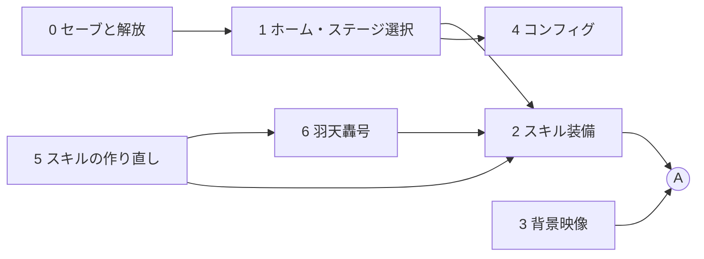

# アウトゲーム 全体実装計画書

アウトゲーム開発期間の全体実装計画。
開発は「全体実装計画 → 区間実装計画 → 詳細仕様確定と実装」の 3 段階で進める。
この文書は全体実装計画で、区間ごとの計画は [Sections/](Sections/) にある。

| 資料 | 場所 |
|---|---|
| ゲーム仕様の正本 | Notion「刻断 / 仕様書」（https://app.notion.com/p/49c1ea2aa7fa83aca214017b9e856040） |
| アウトゲームの仕様 | Notion「仕様リスト / アウトゲーム」（https://app.notion.com/p/3e91ea2aa7fa81e3b271e0fc71189ea6） |
| スキルの仕様 | Notion「仕様リスト / スキル」（https://app.notion.com/p/3e91ea2aa7fa814ebd59e5038006aa39） |
| インゲームの全体計画 | [InGameOverallPlan.md](../InGame/InGameOverallPlan.md) |

作成日：2026-10-19 ／ 更新日：2026-10-19

## 0. 作業者向けの前提

この計画書を受け取って実装する人（AI を含む）は、着手前にここを読む。

### 最初に読むもの

| 対象 | 内容 |
|---|---|
| [InGameOverallPlan.md](../InGame/InGameOverallPlan.md) の 0 章 | 手本にする既存コード、守ること、区間の進め方。アウトゲームでも同じ決まりで進める |
| スキル `state-centrism-architecture` | 5 層の役割、State の Single Writer、Getter インターフェース、参照ルール |
| スキル `usefultoolkit` | BlackBoard・State・Initializer・Compositor・SceneGroup・入力の書き方 |
| [Section11_StageFlow.md](../InGame/Sections/Section11_StageFlow.md) | アウトゲームとインゲームの受け渡し（`GameProgressService`、`GameSceneController`）と、仮のアウトゲームの作り。区間0・1・2で読む |
| [Section17_CloseRangeSkill.md](../InGame/Sections/Section17_CloseRangeSkill.md) | 体術・衝波（旧仮名：頑拳）と体術・攻走（旧仮名：突撃）の計画。区間5で読む |
| [Section18_FinisherBeam.md](../InGame/Sections/Section18_FinisherBeam.md)、[FinisherReference.md](../InGame/FinisherReference.md) | フィニッシャーのビーム。羽天轟号の土台。区間6で読む |

### 手本にする既存コード

| 役割 | 手本 | 要点 |
|---|---|---|
| アウトゲームとインゲームの受け渡し | [GameProgressService](../../Code/Scripts/Application/CoreSystem/GameProgressService.cs)、[GameProgressState](../../Code/Scripts/BlackBoardLayer/CoreSystem/ApplicationManagement/GameProgressState.cs) | 常駐シーンで一度だけ生成する。ステージとスキルは番号（並びの位置）で持つ |
| 設定の State | [OperationSettingService](../../Code/Scripts/Application/CoreSystem/OperationSettingService.cs)、[OperationSettingState](../../Code/Scripts/BlackBoardLayer/CoreSystem/ApplicationManagement/OperationSettingState.cs) | 常駐の `GameStateBase`。保存した値の読み出しは `// TODO:` のまま |
| uGUI の Adapter | [StageHudAdapter](../../Code/Scripts/EngineAdapterLayer/Stage/StageHudAdapter.cs)、[StageResultAdapter](../../Code/Scripts/EngineAdapterLayer/Stage/StageResultAdapter.cs) | State を読んで uGUI に出す。ボタンの操作は Initializer で配線した Service の窓口を呼ぶ |
| 仮のアウトゲーム | [OutGameStartInitializer](../../Code/Scripts/Initialization/Scene/OutGameStartInitializer.cs) | OnGUI の仮の画面。区間1・2で uGUI に置き換えて消す |

### 守ること

- インゲームの全体計画書の「守ること」をそのまま守る（自動生成ファイルを手で直さない、層の参照ルール、コメントは `comment-refactoring` の基準、`Legacy` を使わない）
- アウトゲームの場面シーンは `Assets/Level/Scenes/Master/OutGame/OutGame.unity`。Initializer を置いた・外したら `UsefulToolkit/Generate/Scene Compositor` で `OutGameCompositor` を作り直す
- UI は uGUI（Canvas）で作る。UI Toolkit は使わない（ユーザーの決定）

### 区間の進め方

インゲームの全体計画書の 0 章「区間の進め方」と同じ。確認は uloop のスキルでコンパイルし、プレイモードで画面を操作して確かめる（`uloop-simulate-mouse-ui` でボタンを押す）。クラウドで作業するときは `.claude/docs/CloudSession.md` に従い、確認できなかったことと、ローカルで確かめる手順を報告に書く。

各区間の計画書の「既存コードの確認結果」は、区間0の実装後に書いてある。着手するときは、それが今のコードと合っているかを確かめてから作業計画を立てる。

## 1. 技術前提

| 項目 | 内容 |
|---|---|
| 画面の作り | uGUI（Canvas）。ホームのボタンから、ステージ選択・スキル装備・コンフィグの各画面へ移る |
| 背景 | インゲームのマップを周回するカメラの映像を事前に動画にし、アウトゲームでは動画を流すだけにする。アウトゲームでマップを読み込まない（重い為） |
| スキルの解放 | ステージの初回クリアで解放する。通貨による解放はなくす（2026-10-19 決定） |
| シーン構成 | 常駐シーン（`UsefulToolkitPersistent`）＋ 場面シーン（`OutGame` / `InGame`）。インゲームの全体計画書の技術前提と同じ |

## 2. プラットフォームの方針

PC を先に作る。スマホと VR の対応は、インゲームと同じく後で行う。ボタンの操作は uGUI の EventSystem に任せ、入力の違いは EventSystem の入力モジュールに閉じ込める。キーコンフィグは PC（キーボードとマウス）の割り当てから作る。

## 3. 現状（区間0の実装後）

| 分野 | 状態 |
|---|---|
| アウトゲームの画面 | 一部あり。`OutGameStartInitializer` が OnGUI で、装備枠 3 つ（押すとスキルを順に替える）・ステージのボタン（ロック中は押せない）を並べる仮の画面 |
| ステージの選択と遷移 | あり。`GameSceneController.GoToStageAsync`。一覧はチュートリアル・殲滅・崩壊・ボス戦・到達の 5 つ（テストは外した） |
| クリアの記録 | あり（区間0）。`progress.json` に保存する。前のステージをクリアすると次を選べる |
| 通貨 | なし（区間0で削除） |
| スキルの装備 | 一部あり。装備枠 3。解放済みのスキルだけ、同じスキルは 1 枠だけ（区間0）。各ステージの解放するスキルは区間5まで空で、初期解放は仮にビームと爆発 |
| スキルの中身 | 一部あり。`SkillData` の効果はビーム・爆発・回復・強化型 5 種（区間6・10）。衝波・攻走はインゲームの区間17で計画済み（未着手）。崩爆・羽天轟号はない |
| 背景映像 | なし。Cinemachine 3.1.7 と Timeline 1.8.10 は導入済み。Unity Recorder は未導入 |
| コンフィグ | 一部あり。`OperationSettingState`（ダッシュ・つかむの受け付け方、切断面の回転角度、視点感度）。`setting.json` への保存はある（区間0）。設定の画面はない |
| キーコンフィグ | なし。Input System 1.19.0 は導入済み（`Assets/Level/Data/InputSystem_Actions.inputactions`） |
| 音量 | なし。AudioMixer もない |
| セーブ | あり（区間0）。`JsonSaveStore<T>` で `persistentDataPath/Save/` に書く。消すのはエディタのメニュー `Kizami/Delete Save` |

## 4. 進め方

- 先に、セーブと解放の判定（区間0）を作り、そのうえに画面を載せる。画面は仮の見た目で一周させてから整える
- 背景映像（区間3）とコンフィグ（区間4）は、ほかの区間に依存しないので、どこで行ってもよい
- スキルの中身（区間5・6）はインゲーム側の作業だが、アウトゲームのスキル一覧と一緒に決めた仕様なのでここで管理する。インゲームの区間17とは区間5で統合する
- 各区間は 0 章の「区間の進め方」の順で進める。区間計画書は、着手する直前にその時点の実装に合わせて見直す

## 5. 区間一覧

| # | 区間 | 主な内容 | 前提 | 目安の時期 | 状態 | 計画書 |
|---|---|---|---|---|---|---|
| 0 | 進行のセーブと解放 | 進行（クリア済みのステージ、装備）とコンフィグの保存・読み込み、通貨の削除、ステージのロック、スキルの解放の判定 | ― | 未定 | 実装済み（ローカルでの確認待ち） | [Section00](Sections/Section00_ProgressSave.md) |
| 1 | ホームとステージ選択 | uGUI のホーム、画面の切り替え、ステージ選択（ロック表示） | 0 | 未定 | 未着手 | [Section01](Sections/Section01_HomeStageSelect.md) |
| 2 | スキル装備 | 装備枠 3、スキル一覧（羽天轟号は専用の枠を上に置く）、解放の演出（羽天轟号は特別） | 0, 1 | 未定 | 未着手 | [Section02](Sections/Section02_SkillEquip.md) |
| 3 | 背景映像 | マップを周回するカメラの撮影と書き出し、アウトゲームでのループ再生 | ― | 未定 | 未着手 | [Section03](Sections/Section03_BackgroundVideo.md) |
| 4 | コンフィグ | 既存の設定の画面、キーコンフィグ、音量 | 0, 1 | 未定 | 未着手 | [Section04](Sections/Section04_Config.md) |
| 5 | スキルの作り直し | 7 種への整理、刃術 3 種（10 回振るまで、重ねがけ）、火術・崩爆、インゲーム区間17（衝波・攻走）との統合 | ― | 未定 | 未着手 | [Section05](Sections/Section05_SkillRework.md) |
| 6 | 火術奥義・羽天轟号 | 上空への飛び上がり、チャージ、視点操作できる無敵のビーム、0.5 秒ごとの破壊判定とエネルギー消費、止め方 | 5 | 未定 | 未着手 | [Section06](Sections/Section06_Utenkougou.md) |
| A | マイルストーンA | アウトゲームからステージを選び、装備を替えて遊び、クリアでスキルが解放される | | | | |

- 目安の時期は、ユーザーとスケジュールを決めてから入れる
- 区間3・4・5 は互いに依存しないので、順番を入れ替えられる

依存関係

## 6. 使う既存機能

| 用途 | 使うもの |
|---|---|
| 画面 | uGUI（Canvas、Button、EventSystem） |
| 背景の撮影 | Unity Recorder（公式パッケージ。未導入）、Timeline、Cinemachine（Spline Dolly） |
| 背景の再生 | `VideoPlayer` → `RenderTexture` → `RawImage` |
| キーコンフィグ | Input System の `PerformInteractiveRebinding`、`SaveBindingOverridesAsJson` / `LoadBindingOverridesFromJson`。公式サンプル「Rebinding UI」を参考にする |
| 音量 | `AudioMixer` の Exposed Parameter（スライダーの値を dB にして渡す） |
| 保存 | `JsonSaveStore<T>`（`JsonUtility` と `Application.persistentDataPath/Save/` のファイル。区間0） |
| シーン遷移 | `GameSceneController`（UsefulToolkit の SceneGroup / SceneLoadService） |

## 7. 確定した仕様（2026-10-19）

### ステージ

| 順 | ステージ | 初回クリアで解放するスキル |
|---|---|---|
| 1 | チュートリアル | 刃術・砕剣 |
| 2 | 殲滅 | 刃術・覇剣 |
| 3 | 崩壊 | 刃術・壊剣 |
| 4 | ボス戦 | 火術・崩爆 |
| 5 | 到達 | 火術奥義・羽天轟号 |

- 初めはチュートリアルだけを選べる。前のステージをクリアすると次のステージを選べる。選べないステージはロックして見せる

### スキル

消費はスキルを発動するときに使うエネルギー（チャージ）。装備枠は 3 つで、羽天轟号もこの 3 枠に入れる。同じスキルを 2 つの枠に入れることはできない。

| # | 名前 | 効果 | 消費 | 解放 |
|---|---|---|---|---|
| 1 | 体術・衝波 | 正面を薙ぎ払う（破壊タイプ） | 10 | 初期 |
| 2 | 体術・攻走 | 入力方向へ突進する（破壊タイプ） | 15 | 初期 |
| 3 | 刃術・砕剣 | 通常攻撃に破壊タイプを付ける | 30 | チュートリアル |
| 4 | 刃術・覇剣 | 通常攻撃の範囲と攻撃速度を大きく上げる | 40 | 殲滅 |
| 5 | 刃術・壊剣 | 通常攻撃に粉砕タイプを付ける | 25 | 崩壊 |
| 6 | 火術・崩爆 | 一度で終わる。前後左右に爆弾を 1 つずつ投げ、落ちた所で爆発させる（破壊タイプ） | 50 | ボス戦 |
| 7 | 火術奥義・羽天轟号 | 下の通り | 発動 10 ＋ 判定ごとに 15 | 到達 |

- 刃術は、発動してから通常攻撃を 10 回振るまで続く。刃術どうしは重ねがけでき、効果は両方かかる。効果中に同じ刃術をもう一度発動すると、残りの回数を 10 に戻す
- 羽天轟号
  - 地形を無視して上空へ飛び上がり、少しチャージしてからビームを撃つ
  - 使っている間は無敵で、視点を動かせる
  - ビームは地形を壊し、雑魚敵を一撃で倒し、バリアを壊す
  - 地形の破壊判定は 0.5 秒に 1 回。攻撃範囲の中で最も近い物理オブジェクトを基準にする。判定のたびにエネルギーを 15 使う
  - エネルギーが切れたとき、またはもう一度発動したときに止まる
  - スキル一覧では、ほかの 6 種の上に専用の枠で置く。解放の演出を特別にする（プレイヤーへのご褒美のスキルという位置づけ）

### コンフィグ

- 今ある設定（`OperationSettingState` の項目）に、キーコンフィグと音量（マスター・BGM・SE）を足す

## 8. 未確定の仕様と、決める区間

| 区間 | 決めること |
|---|---|
| 0 | 保存の方式とファイルの形、セーブの時機、テスト用ステージ（`TestStageData`）を一覧に残すか |
| 1 | ホームに置くボタン（ゲームの終了など）、画面の見た目 |
| 2 | 解放の演出の中身（通常と羽天轟号）、スキルの説明文、アイコン |
| 3 | 撮影するマップと周回の経路、動画の解像度・長さ・形式、プラットフォームごとの動画の扱い |
| 4 | 再割り当てできる操作の範囲、重複した割り当ての扱い、音量の段階と初期値 |
| 5 | 覇剣の倍率、崩爆の爆弾の飛距離・爆発の半径・強さ、衝波と攻走の範囲（区間17の決めることと合わせる） |
| 6 | 飛び上がる高さ、チャージの時間、ビームの太さと長さ、「最も近い物理オブジェクト」の探し方、ボス・水晶・装甲への効き方、終わったあとの降り方 |

## 9. 仮定として置いている事項（未確認）

- 体術・衝波と体術・攻走は、インゲームの区間17の「頑拳」「突撃」と同じスキルとする。区間17の「初期装備を頑拳 1 つにする」は、今回の「衝波と攻走が初期」に置き換わる
- 7 種に入っていない既存のスキル（ビーム・爆発・回復・かけらの爆発）は、アウトゲームのスキル一覧から外す。`SkillData` のアセットと効果のコードを消すかは区間5で決める
- 刃術・覇剣は、既存の強化型「範囲アップ」と「速さアップ」を 1 つにまとめたものとする
