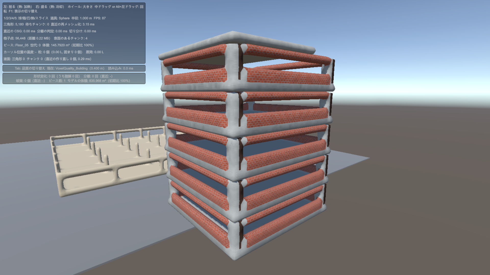
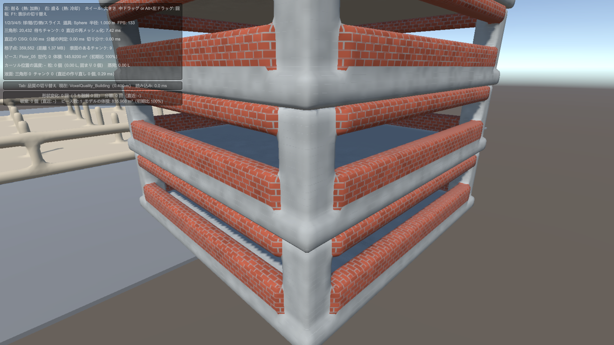
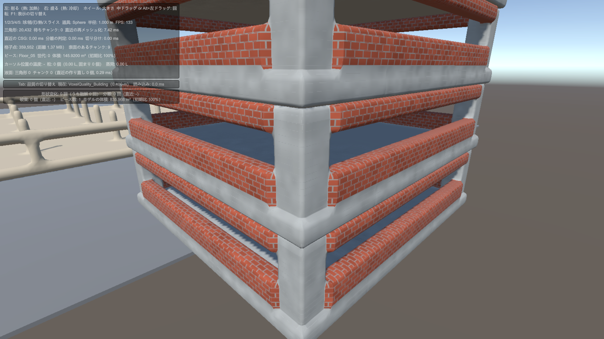
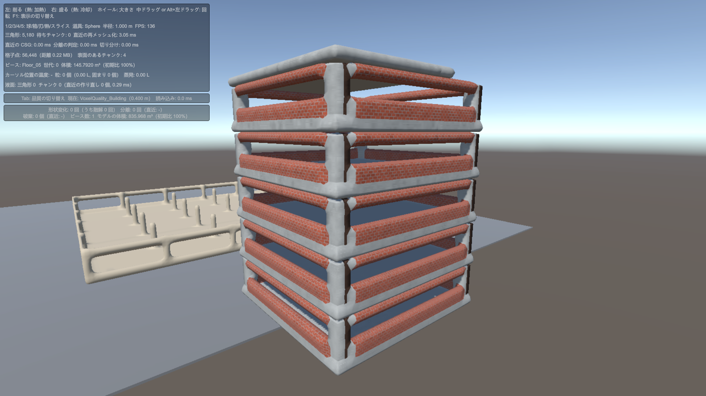
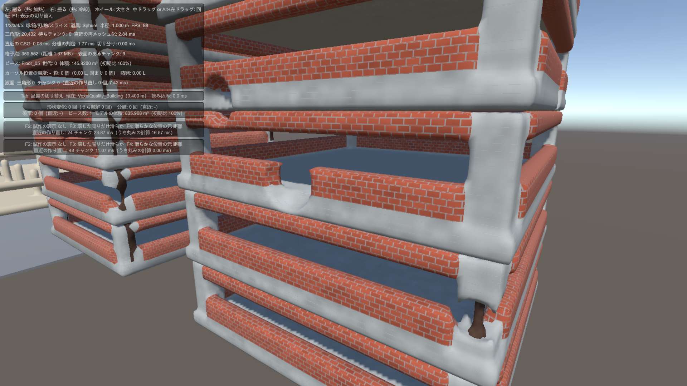
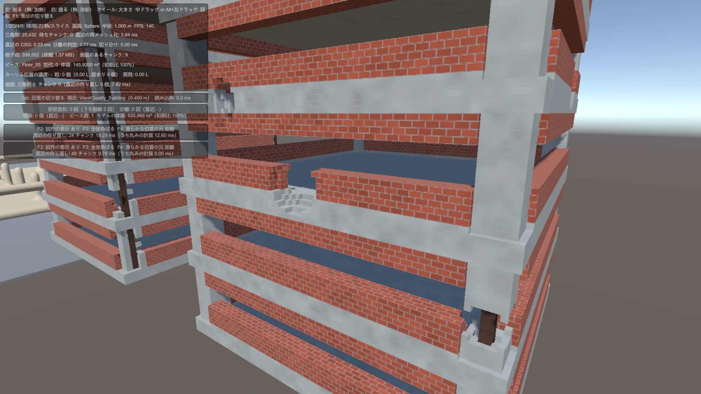
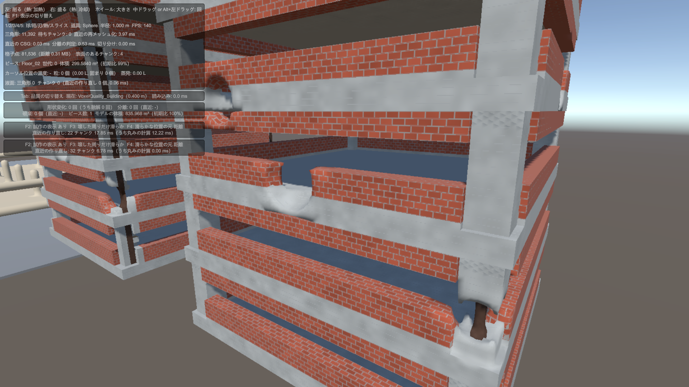
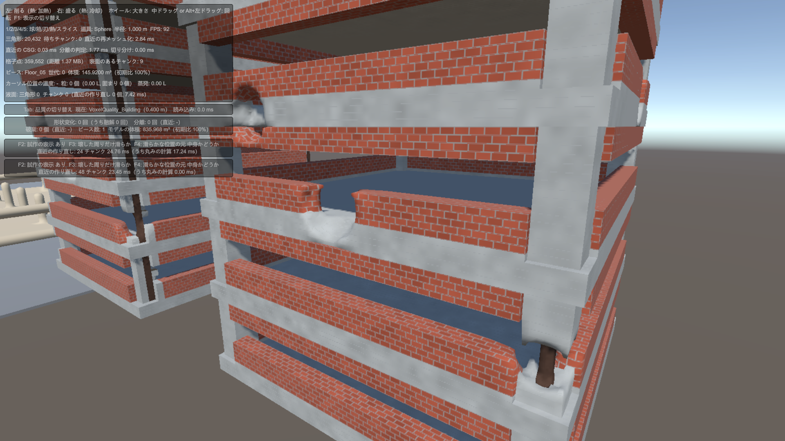
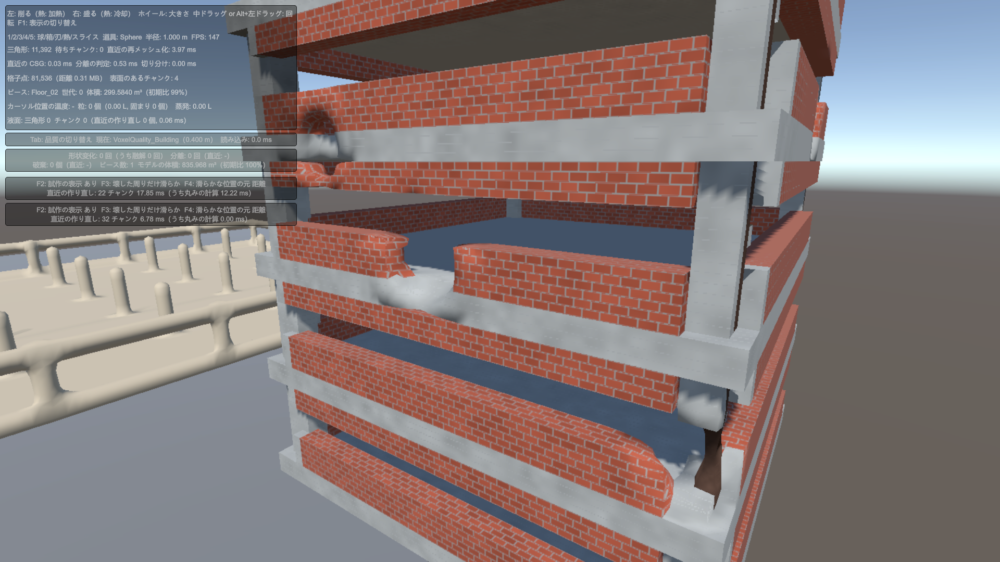
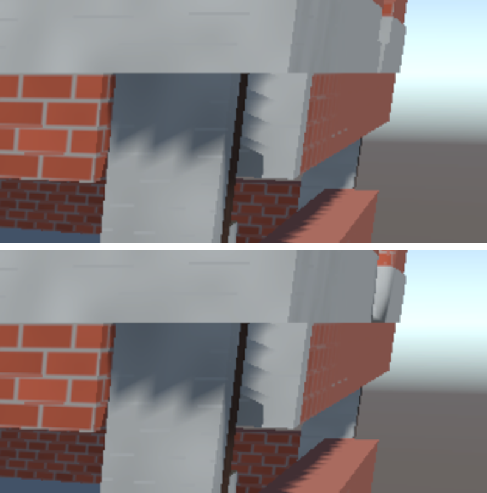

# ボクセルの角ばりの対策の報告（2026-10-14）

区間17 の B-7 の確認で見つかった「建物のボクセルが丸まって角ばらない」問題について、原因の切り分けと対策の試作の結果をまとめる。計画上の扱いは [Section17_LargeVoxelBuilding.md](../InGame/Sections/Section17_LargeVoxelBuilding.md) の「進捗と引き継ぎ」が正本。

## 問題

0.4m のボクセルで、厚さ 0.8m の外壁や梁が筒のように丸まり、階の境目も V 字の溝に見えた。建物を四角く見せるには、丸めの形だけで建物を設計するか、ボクセルの描き方を変える必要がある。

## 原因の切り分け

| 調べたこと | 結果 |
|---|---|
| ベイクの距離場 | 正確。角の外も正しいユークリッド距離。`BuildingFloorTest` はもともと 0.2m でベイクしている |
| 0.2m の形 | ほぼ四角。0.8m 角の帯で、角の頂点のずれは約 0.06m |
| 0.2m で丸く見える理由 | 法線。中心差分を 0.2m 間隔で取る為、平らな面の頂点の法線にも角の向きが混ざり、0.8m の幅で円柱のように回る |
| 0.4m の形 | 部材が 2 セルしかなく、形そのものが 1 辺に頂点 1 つの八角形になる |

0.2m の Surface Nets（左）と、同じメッシュの法線を面から取り直したもの（右）。

| 今の法線 | 面から取り直した法線 |
|---|---|
|  |  |

0.4m は、法線を取り直しても面取りした八角形になる。

## 試した案

### B-7a：Dual Contouring

`SurfaceNetsJob` で、交点と法線から角を保つ点（Dual Contouring）を求め、今の点と混ぜた。角の頂点のずれは 0.2m で 0.067m → 0.059m にしかならず、再メッシュ化が約 1.5ms 重くなった。法線が両側の面の向きの混ざったものになる為、解いた点が平均の点とほぼ同じになる。取り下げた。

### 描き方を変える試作

Surface Nets の頂点をセルの中心に置くと、ボクセルを積んだ角ばった形になる。もとの Surface Nets（Gibson、1998）は、白黒のボリュームから角ばった形を作り、頂点をセルの中で動かして滑らかにする手法で、それに近い。

頂点ごとに 2 つの位置を持ち、頂点ごとの丸み（0〜1）でシェーダーが混ぜる。

| 値 | 中身 |
|---|---|
| 頂点の位置 | 角ばった位置（セルの中心） |
| 法線 | 滑らかな形の法線 |
| UV1 の xyz | 滑らかな位置（今の Surface Nets の位置）までの差 |
| UV1 の w | 丸み |

丸みは、読み込んだときの距離から変わった点（削れた所・融けた所）を 1 とし、周りへ薄めて広げ、素材の強度ごとの倍率を掛けて決める。角ばった形と滑らかな形は四角形の結び方が同じなので、1 つのメッシュのまま混ぜられ、チャンクの境目で隙間も出ない。

シェーダーでは、丸みの無い所は三角形の面の向き（`ddx` / `ddy`）で陰影を付け、角をくっきりさせる。

## 見た目の結果

同じ 4 か所を削った 0.2m の建物を、同じ位置から撮った。

| 今の Surface Nets | 全部角ばる |
|---|---|
|  |  |

| 壊した周りだけ滑らか（距離から） | 壊した周りだけ滑らか（中身かどうかだけから） |
|---|---|
|  |  |

0.4m の建物の「壊した周りだけ滑らか」。

- 0.4m・0.2m とも、建物は角がくっきりした箱になり、階の境目の溝も消えた
- 「壊した周りだけ滑らか」で、建物は四角いまま、削った穴だけ滑らかになる
- 距離を持たず、中身かどうかだけから求めた滑らかさは少しでこぼこするが使える。データを素材の番号だけにしても、見た目の面では成り立つ

## 時間の結果

1 階分を 1 スレッドで全チャンク作った時間。Burst は有効。

| | 0.4m | 0.2m |
|---|---|---|
| 今の Surface Nets | 4.49ms | 26.14ms |
| 試作のメッシュ生成 | 5.31ms | 32.18ms |
| 今の MeshCollider のクッキング | 3.01ms | 10.42ms |
| 試作の箱の当たり判定の Job | 0.36ms | 2.06ms |
| 箱の数（1 階分、削る前 → 4 か所削ったあと） | 35 → 47 | 53 → 93 |
| 箱の数（6 階の建物全体、同じ） | 181 → 215 | 274 → 407 |
| BoxCollider への反映（建物全体） | 0.3〜0.6ms | 1.3〜2.1ms |
| 丸みの計算（6 階分を全部やり直し） | 約 13ms | 73〜83ms |

- メッシュの生成は軽くならない（約 6% 重い）
- 当たり判定は、中身の点を x・y・z の順に伸ばして箱にまとめると、クッキングより 5〜8 倍速い。部材が格子にそろっているので、箱の数も少ない
- 丸みの計算は、ボリューム全体をやり直していて一番重い。変わった範囲だけに絞る必要がある

## 試作で見つけた問題

| 内容 | 状態 |
|---|---|
| 角ばった所で、自分の面に影を落としてジグザグの模様が出た。影のパスが頂点を法線（滑らかな形の向き）へずらす為 | 直した。丸みの無い所では法線の向きにずらさない |
| 穴の縁の、頂点が途中まで動いた所で、三角形ごとに陰影が食い違う | 直した。陰影の法線は、丸みが少しでもあれば頂点の法線に寄せる（`_BlockNormalBlendThreshold`、既定 0.15） |
| 上の床が柱に落とす影のふちが、のこぎり状に見える。シャドウマップの解像度による | 未対応。URP の影の設定で直すかは、採るかを決めてから |
| 0.4m の柱に鉄筋の黒い縦の筋が見える | 今の描画でも出る。試作とは関係しない |

## 採った結果（2026-10-14）

試作は消し、次のとおり今のボクセルに組み込んだ。決めた理由は [区間17 の計画書](../InGame/Sections/Section17_LargeVoxelBuilding.md) の「作業計画の書き直し（2026-10-14）」にある。

| 項目 | 決定 | 組み込んだ場所 |
|---|---|---|
| 描き方 | 角ばった頂点 ＋ 壊した周りだけ滑らか。品質設定で切り替え、敵などは今の描き方のまま | `VoxelQualitySettings.UseBlockShape`、`SurfaceNetsJob.UseBlockShape`、`BuildingPattern.shader` |
| 丸み | 点ごとに byte で持ち、削る・加熱で距離が変わった点に印を付け、変わった範囲だけを広げ直す。素材の強度ごとの倍率はメッシュを作るときに掛ける | `VoxelVolume`（`EnableRoundness`）、`VoxelCsgJob`・`VoxelHeatJob`、`VoxelRoundnessSpreadJob` |
| 当たり判定 | 中身の点をまとめた箱の BoxCollider | `VoxelColliderMode.Boxes`、`VoxelBoxColliderJob` |
| ボクセルの大きさ | 0.4m のまま | `VoxelQuality_Building.asset` |
| 階を N×N の箱に分ける | 今は分けない | ― |
| データ | 距離を持ち続ける | ― |
| 攻撃の種類ごとの丸み | 区間18 で決める | ― |

組み込んだあとの値（0.4m、1 階分）

| | 値 |
|---|---|
| 全チャンクの再メッシュ化（並列、箱の当たり判定込み） | 2.66ms |
| 丸みを広げる時間 | 範囲のサンプル数に比例（約 25ns／点）。半径 1m の攻撃で 0.66ms、1 階分全体で約 2ms |
| 箱の数（6 階の建物） | 181 → 4 か所削って 202 |
| 物理の 1 ステップ（剛体 30 個） | 建物の上 0.097ms、地面 0.109ms |

残ったこと

- プレイヤーと同じ大きさのカプセルを速度で動かすと、箱の継ぎ目で約 6cm 跳ねる。区間17 の B-10 か、レビューのときに本物のプレイヤーで確かめる
- 落ちるかけら（分離したピース）は凸包の当たり判定のまま
